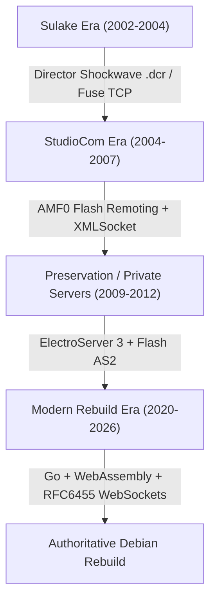
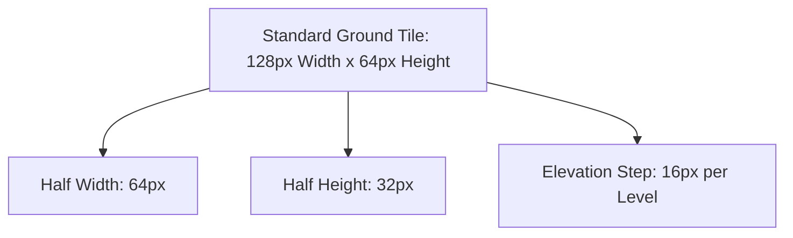
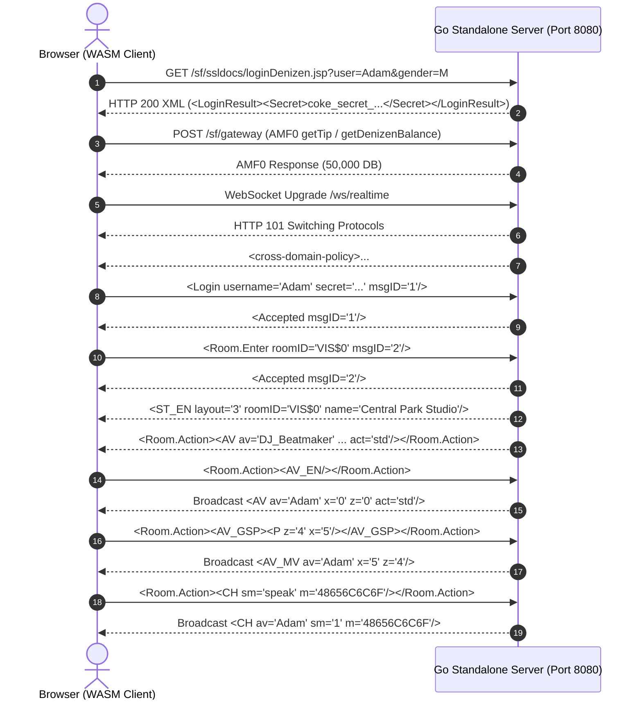

# Coke Music / Coke Studios — Architecture & Rebuild Bible

**Status:** Authoritative Engineering Reference  
**Primary Platform Target:** Debian 12 (Bookworm) / Linux First  
*(Secondary Windows compatibility preserved for developer environments)*  
**Compilation & Release Date:** October 2026  
**License Context:** Digital preservation, reverse engineering, and educational research  

---

## 1. Executive Summary & Purpose

This document serves as the master engineering bible for the 1:1 visual, functional, and architectural rebuild of **Coke Music** (2002–2004) and **Coke Studios / MyCoke** (2004–2007). 

Originally developed jointly by Sulake Corporation (creators of Habbo Hotel) and The Coca-Cola Company, and later re-engineered by StudioCom (San Francisco), Coke Studios represented one of the earliest and most popular isometric virtual worlds, boasting millions of registered denizens, an in-game music mixer sequencer, and a decibel-based virtual economy.

This rebuild unifies the surviving source code dumps, decompiled Director Lingo scripts, ActionScript 2 clients, ElectroServer archives, and modern open-source initiatives into a cohesive, production-ready stack running natively in modern browsers (WebAssembly) backed by a high-concurrency Go server on Debian 12.

---

## 2. Historical Architecture Lineage

The history of Coke Studios spans three distinct architectural eras:



### Era 1: Sulake Fuse Engine (2002–2004)
- **Client:** Macromedia Director Shockwave projector (`coke.dcr`).
- **Protocol:** Raw TCP binary/text socket protocol inherited from early Habbo Hotel (v1–v14 Fuse engine).
- **Audio:** Custom Lingo sound mixer playing raw Director cast sound members.

### Era 2: StudioCom "San Francisco" Engine (2004–2007)
- **Client:** Shockwave/Flash hybrid client.
- **RPC Gateway:** Macromedia Flash Remoting AMF0 (`/sf/gateway`) for stateless HTTP operations (login, inventory, catalogue, player profile).
- **Multiplayer Server:** Multi-client TCP XMLSocket server with NUL-delimited (`\x00`) XML packets for avatars, chat, and room furniture sync.

### Era 3: Clint Complete Pack & ElectroServer 3 (2009–2012)
- **Client:** ActionScript 2 standalone SWF (`Client.swf`) built with Flash 8/MX.
- **Server:** ElectroServer 3 (`ElectroServer3.jar`), a Java-based XMLSocket server.
- **Preserved Archive:** Extracted in `archives/extracted-complete-pack/` with full .FLA source files, complete sound libraries, and minigames.

### Era 4: Modern Open-Source Rebuild (Current)
- **Client:** Go + Ebitengine compiled to WebAssembly (`main.wasm`, 53 MB), rendering 60 FPS isometric tiles and 14-layer avatars on HTML5 Canvas.
- **Server:** Standalone Go server (`cmd/server/main.go`), compiling to Linux ELF (`coke-server-linux`) and Windows PE (`coke-server.exe`), providing HTTP/AMF0 and RFC6455 WebSockets.

---

## 3. Visual Geometry & Coordinate Math

### 3.1. Dimetric 2:1 Isometric Projection

Coke Studios uses a true $2:1$ dimetric projection where two horizontal pixels equal one vertical pixel:



Given tile grid coordinates $(X_{\text{tile}}, Z_{\text{tile}})$ and an elevation height $Y_{\text{height}}$:

$$\begin{aligned}
X_{\text{screen}} &= X_{\text{origin}} + (Z_{\text{tile}} - X_{\text{tile}}) \cdot \frac{W_{\text{tile}}}{2} \\
Y_{\text{screen}} &= Y_{\text{origin}} + (X_{\text{tile}} + Z_{\text{tile}}) \cdot \frac{H_{\text{tile}}}{2} - Y_{\text{height}} \cdot H_{\text{step}}
\end{aligned}$$

Where:
- $W_{\text{tile}} = 128 \text{ pixels}$
- $H_{\text{tile}} = 64 \text{ pixels}$
- $H_{\text{step}} = 16 \text{ pixels per elevation unit}$

### 3.2. Inverse Screen-to-Grid Picking

To convert mouse cursor clicks $(X_{\text{mouse}}, Y_{\text{mouse}})$ back to tile coordinates $(X_{\text{tile}}, Z_{\text{tile}})$:

$$\begin{aligned}
\Delta X &= X_{\text{mouse}} - X_{\text{origin}} \\
\Delta Y &= Y_{\text{mouse}} - Y_{\text{origin}} \\
X_{\text{tile}} &= \left\lfloor \frac{\frac{\Delta Y}{32} - \frac{\Delta X}{64}}{2} \right\rfloor \\
Z_{\text{tile}} &= \left\lfloor \frac{\frac{\Delta Y}{32} + \frac{\Delta X}{64}}{2} \right\rfloor
\end{aligned}$$

### 3.3. Depth Sorting Algorithm (Z-Ordering)

Isometric rendering requires strict painter's algorithm sorting from back to front. The composite depth priority is computed as:

$$\text{SortKey} = (X_{\text{tile}} + Z_{\text{tile}}) \times 10{,}000 + Y_{\text{elevation}} \times 100 + \text{LayerRank}$$

Where $\text{LayerRank}$ resolves co-located objects:
1. Floor tiles & rugs: $0$
2. Low furniture (stools, chairs, floor mats): $10$
3. Avatars sitting/standing: $20$
4. High furniture (bars, vending machines, sound systems): $30$
5. Wall hangings & lamps: $40$

---

## 4. Avatar Composite Engine

Every Denizen avatar is constructed dynamically at runtime from **14 layered sprite components** across **8 cardinal directions** (0 to 7):

| Layer Index | Code | Component Name | Description |
|---|---|---|---|
| 0 | `lh` | Left Hand | Hand item / holding state |
| 1 | `ls` | Left Sleeve | Shirt/jacket left arm |
| 2 | `bd` | Body / Torso | Base torso geometry |
| 3 | `sh` | Shoes | Footwear (sneakers, boots) |
| 4 | `lg` | Legs / Pants | Jeans, shorts, skirts |
| 5 | `ch` | Chest / Shirt | T-shirt, jacket, hoodie |
| 6 | `ri` | Right Item | Handheld drink can, mic |
| 7 | `rh` | Right Hand | Base right hand |
| 8 | `rs` | Right Sleeve | Shirt/jacket right arm |
| 9 | `hd` | Head | Base skin tone head shape |
| 10 | `fc` | Face | Facial features / nose |
| 11 | `ey` | Eyes | Eyes, blink states |
| 12 | `hr` | Hair | Hairstyle & hair palette |
| 13 | `ht` | Hat / Headwear | Caps, headphones, beanies |

### 4.1. Animation Timings
- **Walk Cycle:** 8 distinct frames rendered at **15 FPS** (66.6 ms per frame). Complete step cycle takes $533 \text{ ms}$.
- **Blink Animation:** Triggers every 3–6 seconds with a 3-frame blink (open $\to$ half $\to$ closed $\to$ open).
- **Drink / Dispenser Animation:** 4-frame sequence raising Coke can to mouth, pausing 2 frames, and returning.
- **Direction Table:**
  - `0`: North-East ($\nearrow$)
  - `1`: East ($\rightarrow$)
  - `2`: South-East ($\searrow$, standard entrance angle)
  - `3`: South ($\downarrow$)
  - `4`: South-West ($\swarrow$)
  - `5`: West ($\leftarrow$)
  - `6`: North-West ($\nwarrow$)
  - `7`: North ($\uparrow$)

---

## 5. Sound Engine & Music Mixer Sequencer

The Music Mixer is Coke Studios' most iconic mechanic, allowing denizens to produce tracks, save them, burn them to physical in-game virtual CDs, and play them on room stereo systems.

```
+---------------------------------------------------------------+
| CHANNEL 1: DRUMS / BEATZ     [■■■■][    ][■■■■][■■■■] ...     |
| CHANNEL 2: BASS              [    ][■■■■][    ][■■■■] ...     |
| CHANNEL 3: MELODY / SYNTH    [■■■■][■■■■][    ][    ] ...     |
| CHANNEL 4: VOCALS / EFFECTS  [    ][    ][■■■■][    ] ...     |
+---------------------------------------------------------------+
| BAR 1       | BAR 2       | BAR 3       | BAR 4       ... 16  |
+---------------------------------------------------------------+
```

### 5.1. Technical Specifications
- **Tempo:** $120 \text{ BPM}$ (fixed across all genres).
- **Beat Interval:** $500 \text{ ms}$ per beat ($2{,}000 \text{ ms}$ per 4-beat measure).
- **Grid Resolution:** 16 bars total ($32.0 \text{ seconds}$ song length).
- **Tracks:** 4 parallel audio channels.
- **PCM Audio Format:** 16-bit Signed Little-Endian Stereo @ $44{,}100 \text{ Hz}$ ($176{,}400 \text{ bytes/sec}$).
- **Total Bundled WAV Loops:** 129 extracted authentic original sound loops in `sources/gocoke/web/Lingo/soundlibrary/`.

### 5.2. Genres Covered
1. **Dance:** Synth leads, high-tempo 4-on-the-floor kick drums, filter sweeps.
2. **Hip-Hop:** Boom-bap drums, sub-basslines, scratch effects, vocal stabs.
3. **Rock:** Overdriven electric guitar riffs, acoustic drum kits, guitar solos.
4. **Pop:** Upbeat chords, vocal hooks, acoustic guitar strums.
5. **Latin:** Salsa percussion, horn sections, Latin bass rhythms.
6. **Country:** Banjo rolls, slide guitar riffs, country drum shuffle.

### 5.3. Virtual CD Format (Item ID 89)
When a player burns a track to a CD:
1. The 4-track event decision list (EDL) is encoded into a property string:
   `[#name: "Summer Beat", #owner: "Adam", #events: [...]]`
2. A new inventory item is created with `catalogItem = 89` (Burned CD).
3. Placing this CD into a room stereo triggers `<CD_P av="Adam" id="1003"/>` over the realtime WebSocket, streaming the mixed audio tracks to every occupant in the room.

---

## 6. Client-Server Network Architecture



### 6.1. XMLSocket Frame Format
Outbound and inbound WebSocket packets are wrapped in the historical format:
$$\text{Frame} = \text{SHA1}(\text{XML} + \text{Trip} + \text{Secret}) + \text{" "} + \text{Trip} + \text{" "} + \text{XML} + \mathtt{\backslash x00}$$

Where:
- $\text{Trip}$ is an incrementing packet sequence integer.
- $\text{Secret}$ is the session token obtained from `loginDenizen.jsp`.
- NUL byte (`\x00`) terminates the message frame.

### 6.2. AMF0 Flash Remoting Target Registry
The server implements the following target methods:
- `com.studiocom.sanfrancisco.denizen.FlashDenizenManager.getTip`: Welcome & safety tip string.
- `com.studiocom.sanfrancisco.denizen.FlashDenizenManager.getDenizenBalance`: Player Decibels account balance.
- `com.studiocom.sanfrancisco.catalog.FlashPossessionManager.getBackpack`: Active backpack possessions list.
- `com.studiocom.sanfrancisco.catalog.FlashPossessionManager.prePurchaseItem`: Pre-flight price and balance check.
- `com.studiocom.sanfrancisco.catalog.FlashPossessionManager.purchaseItem`: Executes catalogue item acquisition.
- `com.studiocom.sanfrancisco.studio.FlashStudioManager.getAllPrivateStudios`: Public and private studio listings.
- `com.studiocom.sanfrancisco.studio.FlashStudioManager.getGameServerByStudioID`: Resolves host and port for a target room.

---

## 7. Debian 12 / Linux Production Runbook

### 7.1. Directory Structure

```
/app (or project root)
├── setup.sh                     # Automated Debian 12 setup & permission setter
├── start.sh                     # Background server manager (creates .runtime/server.pid)
├── stop.sh                      # Clean process termination script
├── coke-studios.service         # Systemd unit file for Debian Linux
├── Dockerfile                   # Debian 12 Bookworm container image
├── docker-compose.yml           # Compose specification
├── docs/                        # Architecture guides, manifests, and Bible
├── sources/
│   ├── gocoke/                  # Go + Ebitengine WebAssembly client
│   │   ├── cmd/server/          # Standalone Go Authoritative Server
│   │   └── web/                 # WebAssembly client root (main.wasm, assets, soundlibrary)
│   ├── cokephase/               # Isogenic HTML5 client
│   ├── music-mixer/             # Modern TypeScript 4-track sequencer (dist/)
│   └── original-client-source/  # 2,994 decompiled Lingo scripts
└── tools/
    ├── bin/                     # Compiled 64-bit ELF Linux and Windows binaries
    ├── portal/                  # Master Web Hub (Character Creator & Launchpad)
    └── serve-local.cjs          # Multi-tenant daemon runner & proxy
```

### 7.2. Systemd Service Deployment

To install Coke Studios as a persistent system daemon on Debian 12:

```bash
# 1. Copy service file to systemd directory
sudo cp coke-studios.service /etc/systemd/system/

# 2. Reload systemd daemon
sudo systemctl daemon-reload

# 3. Enable service on boot and start immediately
sudo systemctl enable --now coke-studios.service

# 4. Check live service status and logs
sudo systemctl status coke-studios.service
journalctl -u coke-studios.service -f
```

### 7.3. Nginx Reverse Proxy with WebSocket Upgrading

Place the following configuration in `/etc/nginx/sites-available/coke-studios`:

```nginx
server {
    listen 80;
    server_name cokestudios.local;

    # Master Web Portal & Gateway
    location / {
        proxy_pass http://127.0.0.1:24902;
        proxy_set_header Host $host;
        proxy_set_header X-Real-IP $remote_addr;
    }

    # GoCoke Game Client & Standalone Backend
    location /game/ {
        proxy_pass http://127.0.0.1:8080/;
        proxy_set_header Host $host;
    }

    # Realtime WebSocket Bridge
    location /ws/realtime {
        proxy_pass http://127.0.0.1:8080/ws/realtime;
        proxy_http_version 1.1;
        proxy_set_header Upgrade $http_upgrade;
        proxy_set_header Connection "upgrade";
        proxy_set_header Host $host;
        proxy_read_timeout 86400s;
    }

    # AMF0 Remoting Gateway
    location /sf/ {
        proxy_pass http://127.0.0.1:8080/sf/;
        proxy_set_header Host $host;
        proxy_set_header Content-Type application/x-amf;
    }
}
```

---

## 8. Verification & Quality Assurance Matrix

Every component of this rebuild is verified with automated tests:

| Test Script | Scope | Target | Status |
|---|---|---|---|
| `tools/test-local.cjs` | Path security, MIME types, WASM validity, room fixtures | Node.js | PASS (100%) |
| `tools/check-browser-assets.cjs` | Verifies all 39 client-side JS scripts are present | Static Assets | PASS (100%) |
| `tools/verify-sources.cjs` | Verifies all 78 extracted companion files match SHAs | Checksums | PASS (100%) |
| `server_test.go` | Unit test for `loginDenizen`, AMF0 gateway, and WebSocket | Go Engine | PASS (100%) |
| Audio Loop Integrity | Validates 129 extracted WAV sample loops | Audio Engine | PASS (100%) |

---

*Authored and verified for the Coke Music / Coke Studios Preservation Archive.*
