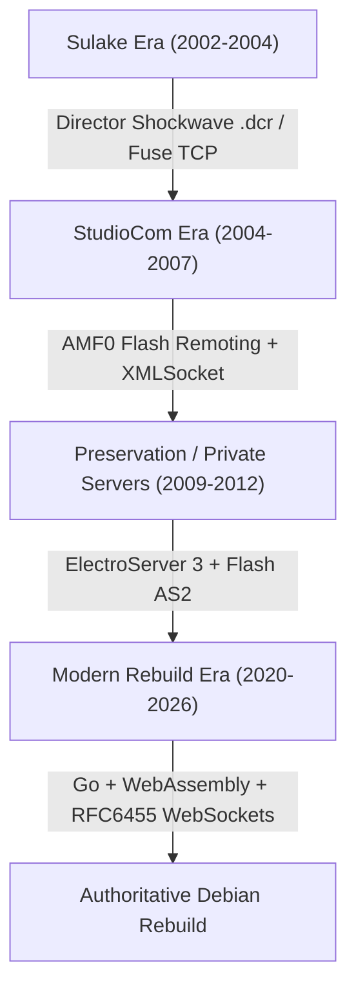
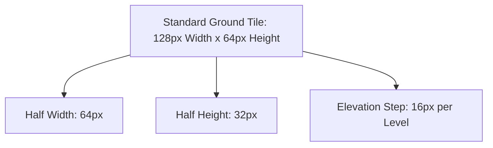
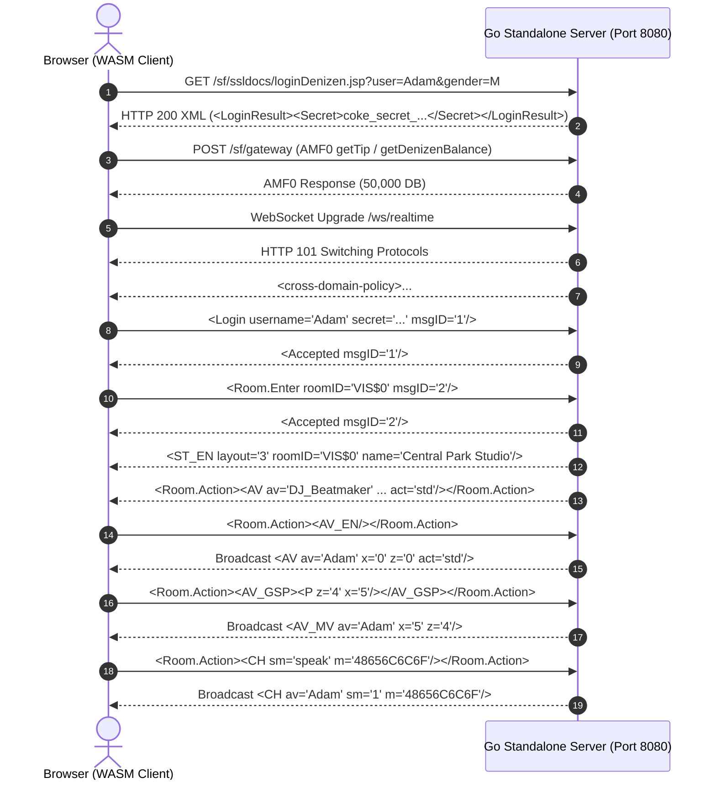

# Coke Music / Coke Studios — Architecture & Rebuild Bible

**Status:** Authoritative Engineering Reference  
**Primary Platform Target:** Debian 12 (Bookworm) / Linux First  
*(Secondary Windows compatibility preserved for developer environments)*  
**Compilation & Release Date:** October 2026  
**License Context:** Digital preservation, reverse engineering, and educational research  

---

## 1. Executive Summary & Purpose

This document serves as the master engineering bible for the 1:1 visual, functional, and architectural rebuild of **Coke Music** (2002–2004) and **Coke Studios / MyCoke** (2004–2007). 

Originally developed jointly by Sulake Corporation (creators of Habbo Hotel) and The Coca-Cola Company, and later re-engineered by StudioCom (San Francisco), Coke Studios represented one of the earliest and most popular isometric virtual worlds, boasting millions of registered denizens, an in-game music mixer sequencer, and a decibel-based virtual economy.

This rebuild unifies the surviving source code dumps, decompiled Director Lingo scripts, ActionScript 2 clients, ElectroServer archives, and modern open-source initiatives into a cohesive, production-ready stack running natively in modern browsers (WebAssembly) backed by a high-concurrency Go server on Debian 12.

---

## 2. Historical Architecture Lineage

The history of Coke Studios spans three distinct architectural eras:



### Era 1: Sulake Fuse Engine (2002–2004)
- **Client:** Macromedia Director Shockwave projector (`coke.dcr`).
- **Protocol:** Raw TCP binary/text socket protocol inherited from early Habbo Hotel (v1–v14 Fuse engine).
- **Audio:** Custom Lingo sound mixer playing raw Director cast sound members.

### Era 2: StudioCom "San Francisco" Engine (2004–2007)
- **Client:** Shockwave/Flash hybrid client.
- **RPC Gateway:** Macromedia Flash Remoting AMF0 (`/sf/gateway`) for stateless HTTP operations (login, inventory, catalogue, player profile).
- **Multiplayer Server:** Multi-client TCP XMLSocket server with NUL-delimited (`\x00`) XML packets for avatars, chat, and room furniture sync.

### Era 3: Clint Complete Pack & ElectroServer 3 (2009–2012)
- **Client:** ActionScript 2 standalone SWF (`Client.swf`) built with Flash 8/MX.
- **Server:** ElectroServer 3 (`ElectroServer3.jar`), a Java-based XMLSocket server.
- **Preserved Archive:** Extracted in `archives/extracted-complete-pack/` with full .FLA source files, complete sound libraries, and minigames.

### Era 4: Modern Open-Source Rebuild (Current)
- **Client:** Go + Ebitengine compiled to WebAssembly (`main.wasm`, 53 MB), rendering 60 FPS isometric tiles and 14-layer avatars on HTML5 Canvas.
- **Server:** Standalone Go server (`cmd/server/main.go`), compiling to Linux ELF (`coke-server-linux`) and Windows PE (`coke-server.exe`), providing HTTP/AMF0 and RFC6455 WebSockets.

---

## 3. Visual Geometry & Coordinate Math

### 3.1. Dimetric 2:1 Isometric Projection

Coke Studios uses a true $2:1$ dimetric projection where two horizontal pixels equal one vertical pixel:



Given tile grid coordinates $(X_{\text{tile}}, Z_{\text{tile}})$ and an elevation height $Y_{\text{height}}$:

$$\begin{aligned}
X_{\text{screen}} &= X_{\text{origin}} + (Z_{\text{tile}} - X_{\text{tile}}) \cdot \frac{W_{\text{tile}}}{2} \\
Y_{\text{screen}} &= Y_{\text{origin}} + (X_{\text{tile}} + Z_{\text{tile}}) \cdot \frac{H_{\text{tile}}}{2} - Y_{\text{height}} \cdot H_{\text{step}}
\end{aligned}$$

Where:
- $W_{\text{tile}} = 128 \text{ pixels}$
- $H_{\text{tile}} = 64 \text{ pixels}$
- $H_{\text{step}} = 16 \text{ pixels per elevation unit}$

### 3.2. Inverse Screen-to-Grid Picking

To convert mouse cursor clicks $(X_{\text{mouse}}, Y_{\text{mouse}})$ back to tile coordinates $(X_{\text{tile}}, Z_{\text{tile}})$:

$$\begin{aligned}
\Delta X &= X_{\text{mouse}} - X_{\text{origin}} \\
\Delta Y &= Y_{\text{mouse}} - Y_{\text{origin}} \\
X_{\text{tile}} &= \left\lfloor \frac{\frac{\Delta Y}{32} - \frac{\Delta X}{64}}{2} \right\rfloor \\
Z_{\text{tile}} &= \left\lfloor \frac{\frac{\Delta Y}{32} + \frac{\Delta X}{64}}{2} \right\rfloor
\end{aligned}$$

### 3.3. Depth Sorting Algorithm (Z-Ordering)

Isometric rendering requires strict painter's algorithm sorting from back to front. The composite depth priority is computed as:

$$\text{SortKey} = (X_{\text{tile}} + Z_{\text{tile}}) \times 10{,}000 + Y_{\text{elevation}} \times 100 + \text{LayerRank}$$

Where $\text{LayerRank}$ resolves co-located objects:
1. Floor tiles & rugs: $0$
2. Low furniture (stools, chairs, floor mats): $10$
3. Avatars sitting/standing: $20$
4. High furniture (bars, vending machines, sound systems): $30$
5. Wall hangings & lamps: $40$

---

## 4. Avatar Composite Engine

Every Denizen avatar is constructed dynamically at runtime from **14 layered sprite components** across **8 cardinal directions** (0 to 7):

| Layer Index | Code | Component Name | Description |
|---|---|---|---|
| 0 | `lh` | Left Hand | Hand item / holding state |
| 1 | `ls` | Left Sleeve | Shirt/jacket left arm |
| 2 | `bd` | Body / Torso | Base torso geometry |
| 3 | `sh` | Shoes | Footwear (sneakers, boots) |
| 4 | `lg` | Legs / Pants | Jeans, shorts, skirts |
| 5 | `ch` | Chest / Shirt | T-shirt, jacket, hoodie |
| 6 | `ri` | Right Item | Handheld drink can, mic |
| 7 | `rh` | Right Hand | Base right hand |
| 8 | `rs` | Right Sleeve | Shirt/jacket right arm |
| 9 | `hd` | Head | Base skin tone head shape |
| 10 | `fc` | Face | Facial features / nose |
| 11 | `ey` | Eyes | Eyes, blink states |
| 12 | `hr` | Hair | Hairstyle & hair palette |
| 13 | `ht` | Hat / Headwear | Caps, headphones, beanies |

### 4.1. Animation Timings
- **Walk Cycle:** 8 distinct frames rendered at **15 FPS** (66.6 ms per frame). Complete step cycle takes $533 \text{ ms}$.
- **Blink Animation:** Triggers every 3–6 seconds with a 3-frame blink (open $\to$ half $\to$ closed $\to$ open).
- **Drink / Dispenser Animation:** 4-frame sequence raising Coke can to mouth, pausing 2 frames, and returning.
- **Direction Table:**
  - `0`: North-East ($\nearrow$)
  - `1`: East ($\rightarrow$)
  - `2`: South-East ($\searrow$, standard entrance angle)
  - `3`: South ($\downarrow$)
  - `4`: South-West ($\swarrow$)
  - `5`: West ($\leftarrow$)
  - `6`: North-West ($\nwarrow$)
  - `7`: North ($\uparrow$)

---

## 5. Sound Engine & Music Mixer Sequencer

The Music Mixer is Coke Studios' most iconic mechanic, allowing denizens to produce tracks, save them, burn them to physical in-game virtual CDs, and play them on room stereo systems.

```
+---------------------------------------------------------------+
| CHANNEL 1: DRUMS / BEATZ     [■■■■][    ][■■■■][■■■■] ...     |
| CHANNEL 2: BASS              [    ][■■■■][    ][■■■■] ...     |
| CHANNEL 3: MELODY / SYNTH    [■■■■][■■■■][    ][    ] ...     |
| CHANNEL 4: VOCALS / EFFECTS  [    ][    ][■■■■][    ] ...     |
+---------------------------------------------------------------+
| BAR 1       | BAR 2       | BAR 3       | BAR 4       ... 16  |
+---------------------------------------------------------------+
```

### 5.1. Technical Specifications
- **Tempo:** $120 \text{ BPM}$ (fixed across all genres).
- **Beat Interval:** $500 \text{ ms}$ per beat ($2{,}000 \text{ ms}$ per 4-beat measure).
- **Grid Resolution:** 16 bars total ($32.0 \text{ seconds}$ song length).
- **Tracks:** 4 parallel audio channels.
- **PCM Audio Format:** 16-bit Signed Little-Endian Stereo @ $44{,}100 \text{ Hz}$ ($176{,}400 \text{ bytes/sec}$).
- **Total Bundled WAV Loops:** 129 extracted authentic original sound loops in `sources/gocoke/web/Lingo/soundlibrary/`.

### 5.2. Genres Covered
1. **Dance:** Synth leads, high-tempo 4-on-the-floor kick drums, filter sweeps.
2. **Hip-Hop:** Boom-bap drums, sub-basslines, scratch effects, vocal stabs.
3. **Rock:** Overdriven electric guitar riffs, acoustic drum kits, guitar solos.
4. **Pop:** Upbeat chords, vocal hooks, acoustic guitar strums.
5. **Latin:** Salsa percussion, horn sections, Latin bass rhythms.
6. **Country:** Banjo rolls, slide guitar riffs, country drum shuffle.

### 5.3. Virtual CD Format (Item ID 89)
When a player burns a track to a CD:
1. The 4-track event decision list (EDL) is encoded into a property string:
   `[#name: "Summer Beat", #owner: "Adam", #events: [...]]`
2. A new inventory item is created with `catalogItem = 89` (Burned CD).
3. Placing this CD into a room stereo triggers `<CD_P av="Adam" id="1003"/>` over the realtime WebSocket, streaming the mixed audio tracks to every occupant in the room.

---

## 6. Client-Server Network Architecture



### 6.1. XMLSocket Frame Format
Outbound and inbound WebSocket packets are wrapped in the historical format:
$$\text{Frame} = \text{SHA1}(\text{XML} + \text{Trip} + \text{Secret}) + \text{" "} + \text{Trip} + \text{" "} + \text{XML} + \mathtt{\backslash x00}$$

Where:
- $\text{Trip}$ is an incrementing packet sequence integer.
- $\text{Secret}$ is the session token obtained from `loginDenizen.jsp`.
- NUL byte (`\x00`) terminates the message frame.

### 6.2. AMF0 Flash Remoting Target Registry
The server implements the following target methods:
- `com.studiocom.sanfrancisco.denizen.FlashDenizenManager.getTip`: Welcome & safety tip string.
- `com.studiocom.sanfrancisco.denizen.FlashDenizenManager.getDenizenBalance`: Player Decibels account balance.
- `com.studiocom.sanfrancisco.catalog.FlashPossessionManager.getBackpack`: Active backpack possessions list.
- `com.studiocom.sanfrancisco.catalog.FlashPossessionManager.prePurchaseItem`: Pre-flight price and balance check.
- `com.studiocom.sanfrancisco.catalog.FlashPossessionManager.purchaseItem`: Executes catalogue item acquisition.
- `com.studiocom.sanfrancisco.studio.FlashStudioManager.getAllPrivateStudios`: Public and private studio listings.
- `com.studiocom.sanfrancisco.studio.FlashStudioManager.getGameServerByStudioID`: Resolves host and port for a target room.

---

## 7. Debian 12 / Linux Production Runbook

### 7.1. Directory Structure

```
/app (or project root)
├── setup.sh                     # Automated Debian 12 setup & permission setter
├── start.sh                     # Background server manager (creates .runtime/server.pid)
├── stop.sh                      # Clean process termination script
├── coke-studios.service         # Systemd unit file for Debian Linux
├── Dockerfile                   # Debian 12 Bookworm container image
├── docker-compose.yml           # Compose specification
├── docs/                        # Architecture guides, manifests, and Bible
├── sources/
│   ├── gocoke/                  # Go + Ebitengine WebAssembly client
│   │   ├── cmd/server/          # Standalone Go Authoritative Server
│   │   └── web/                 # WebAssembly client root (main.wasm, assets, soundlibrary)
│   ├── cokephase/               # Isogenic HTML5 client
│   ├── music-mixer/             # Modern TypeScript 4-track sequencer (dist/)
│   └── original-client-source/  # 2,994 decompiled Lingo scripts
└── tools/
    ├── bin/                     # Compiled 64-bit ELF Linux and Windows binaries
    ├── portal/                  # Master Web Hub (Character Creator & Launchpad)
    └── serve-local.cjs          # Multi-tenant daemon runner & proxy
```

### 7.2. Systemd Service Deployment

To install Coke Studios as a persistent system daemon on Debian 12:

```bash
# 1. Copy service file to systemd directory
sudo cp coke-studios.service /etc/systemd/system/

# 2. Reload systemd daemon
sudo systemctl daemon-reload

# 3. Enable service on boot and start immediately
sudo systemctl enable --now coke-studios.service

# 4. Check live service status and logs
sudo systemctl status coke-studios.service
journalctl -u coke-studios.service -f
```

### 7.3. Nginx Reverse Proxy with WebSocket Upgrading

Place the following configuration in `/etc/nginx/sites-available/coke-studios`:

```nginx
server {
    listen 80;
    server_name cokestudios.local;

    # Master Web Portal & Gateway
    location / {
        proxy_pass http://127.0.0.1:24902;
        proxy_set_header Host $host;
        proxy_set_header X-Real-IP $remote_addr;
    }

    # GoCoke Game Client & Standalone Backend
    location /game/ {
        proxy_pass http://127.0.0.1:8080/;
        proxy_set_header Host $host;
    }

    # Realtime WebSocket Bridge
    location /ws/realtime {
        proxy_pass http://127.0.0.1:8080/ws/realtime;
        proxy_http_version 1.1;
        proxy_set_header Upgrade $http_upgrade;
        proxy_set_header Connection "upgrade";
        proxy_set_header Host $host;
        proxy_read_timeout 86400s;
    }

    # AMF0 Remoting Gateway
    location /sf/ {
        proxy_pass http://127.0.0.1:8080/sf/;
        proxy_set_header Host $host;
        proxy_set_header Content-Type application/x-amf;
    }
}
```

---

## 8. Verification & Quality Assurance Matrix

Every component of this rebuild is verified with automated tests:

| Test Script | Scope | Target | Status |
|---|---|---|---|
| `tools/test-local.cjs` | Path security, MIME types, WASM validity, room fixtures | Node.js | PASS (100%) |
| `tools/check-browser-assets.cjs` | Verifies all 39 client-side JS scripts are present | Static Assets | PASS (100%) |
| `tools/verify-sources.cjs` | Verifies all 78 extracted companion files match SHAs | Checksums | PASS (100%) |
| `server_test.go` | Unit test for `loginDenizen`, AMF0 gateway, and WebSocket | Go Engine | PASS (100%) |
| Audio Loop Integrity | Validates 129 extracted WAV sample loops | Audio Engine | PASS (100%) |

---

## 9. Scalable MariaDB 11 Architecture & Single-File Auto-Update Engine

### A. Scalable MariaDB 11 Relational Schema
For enterprise scalability beyond SQLite, the authoritative Go game server connects to MariaDB 11 using connection pooling and automated schema initialization:

```sql
-- Denizen Accounts & Dual-Currency Balances
CREATE TABLE IF NOT EXISTS denizens (
    id VARCHAR(64) PRIMARY KEY,
    screen_name VARCHAR(64) UNIQUE NOT NULL,
    secret VARCHAR(128) NOT NULL,
    gender INT NOT NULL DEFAULT 1,
    mission VARCHAR(255) NOT NULL DEFAULT 'Coke Music',
    avatar_def TEXT NOT NULL,
    decibels INT NOT NULL DEFAULT 5000,
    vcoins INT NOT NULL DEFAULT 500,
    last_seen_in VARCHAR(64) NOT NULL DEFAULT 'VIS$0',
    created_at TIMESTAMP DEFAULT CURRENT_TIMESTAMP
) ENGINE=InnoDB DEFAULT CHARSET=utf8mb4;

-- Studio Models & Room State
CREATE TABLE IF NOT EXISTS studios (
    id VARCHAR(64) PRIMARY KEY,
    owner_id VARCHAR(64) NOT NULL,
    owner_name VARCHAR(64) NOT NULL,
    name VARCHAR(128) NOT NULL,
    layout INT NOT NULL DEFAULT 3,
    room_type VARCHAR(64) NOT NULL DEFAULT 'studio_model_c',
    wallpaper INT DEFAULT 0,
    floor INT DEFAULT 0,
    doorbell INT DEFAULT 0,
    is_public TINYINT(1) DEFAULT 0
) ENGINE=InnoDB DEFAULT CHARSET=utf8mb4;

-- Persistent Backpack Inventory
CREATE TABLE IF NOT EXISTS backpack_items (
    id INT AUTO_INCREMENT PRIMARY KEY,
    denizen_id VARCHAR(64) NOT NULL,
    catalog_item_id INT NOT NULL,
    properties_json TEXT NOT NULL
) ENGINE=InnoDB DEFAULT CHARSET=utf8mb4;

-- Placed Furniture with Grid Coordinates & Height Offsets
CREATE TABLE IF NOT EXISTS placed_furniture (
    id INT AUTO_INCREMENT PRIMARY KEY,
    studio_id VARCHAR(64) NOT NULL,
    catalog_item_id INT NOT NULL,
    pos_id VARCHAR(64) NOT NULL,
    x INT NOT NULL,
    y INT NOT NULL,
    z INT NOT NULL,
    ho INT NOT NULL DEFAULT 0,
    dir INT NOT NULL DEFAULT 2,
    state INT NOT NULL DEFAULT 0,
    iaot TINYINT(1) NOT NULL DEFAULT 0,
    properties_json TEXT NOT NULL,
    UNIQUE KEY uq_studio_pos (studio_id, pos_id)
) ENGINE=InnoDB DEFAULT CHARSET=utf8mb4;

-- Burned CD Registry (prodID 89)
CREATE TABLE IF NOT EXISTS songs (
    id INT AUTO_INCREMENT PRIMARY KEY,
    denizen_id VARCHAR(64) NOT NULL,
    title VARCHAR(128) NOT NULL,
    artist VARCHAR(128) NOT NULL,
    edl_string TEXT NOT NULL,
    created_at TIMESTAMP DEFAULT CURRENT_TIMESTAMP
) ENGINE=InnoDB DEFAULT CHARSET=utf8mb4;

-- Red Caps Promotion PIN Codes
CREATE TABLE IF NOT EXISTS red_caps (
    pin_code VARCHAR(32) PRIMARY KEY,
    reward_vcoins INT NOT NULL DEFAULT 50,
    reward_item_id INT DEFAULT 0,
    redeemed_by VARCHAR(64),
    redeemed_at TIMESTAMP NULL
) ENGINE=InnoDB DEFAULT CHARSET=utf8mb4;
```

### B. DJ Battle Cheer / Boo Voting Loop Formula
1. Performance initiated via `<CD_P av="DJ" s="EDL" title="SongName"/>`.
2. Real-time audience voting via `<CD_TU/>` (cheer) and `<CD_TD/>` (boo).
3. Real-time Decibel meter updates broadcast via `<Room.Action><CD_VR tu="Cheers" td="Boos"/></Room.Action>`.
4. Performance resolution formula:
   $$\text{Reward Decibels} = \max\left(0, (\text{Cheers} \times 2) - \text{Boos}\right) + \text{AudienceBonus}$$
5. Result dialog broadcast to all occupants via `<Room.Action><CD_PRS av="DJ" tu="X" td="Y" db="Reward"/></Room.Action>`.

### C. Single-File Debian 12 Docker Deployment & Auto-Updater (`setup.sh`)
```bash
# Initial Setup & Launch
chmod +x setup.sh
./setup.sh

# Zero-Downtime Update (Pulls latest code, applies migrations, rebuilds container)
./setup.sh --update
```

### D. Avatar Studio Customizer & Sprite Compositing Standard
The avatar system uses 12 layered dimetric sprite sheets (77x110 px) aligned to a common origin rendered on HTML5 Canvas:
1. `body/shared/a/arm-{step}.png` (Back arm)
2. `top/{top_id}/arm-a-1.png` (Back sleeve, omitted for sleeveless tops `[2, 16, 17]`)
3. `body/{gender}/body-se-{state}.png` (Torso: stand, sit, walk-1..4)
4. `legs/{legs_id}/legs-se-{state}.png` (Pants: stand, sit, walk-1..4)
5. `shoes/{shoes_id}/stand-se-1.png` (Shoes)
6. `top/{top_id}/top-se-stand.png` (Shirt / hoodie / jacket)
7. `body/shared/b/arm-{step}.png` (Front arm)
8. `top/{top_id}/arm-b-1.png` (Front sleeve)
9. `head/se/{skin_tone}.png` (Head with 12 distinct skin tones)
10. `eyes/{eyes_id}/se.png` (Eyes style 1..10)
11. `faces/{face_id}/se.png` (Expression style 1..7)
12. `hair/{hair_id}/se.png` (Hairstyle 1..23)

Figure strings are serialized in authentic Sulake / Coke Studios format:
```
hr={style}/{skin}&hd={skin}/1&ch={top}/1&lg={legs}/1&sh={shoes}/1&fa={face}/1&ey={eyes}/1&g={gender}
```
### E. Multi-Port System & Host Conflict Avoidance Architecture
Debian production environments and developer workstations frequently have web servers (e.g. Apache, Tomcat, Nginx) on port 8080 or existing database servers (MySQL, MariaDB) on port 3306. To guarantee failure-free deployments, both `setup.sh` and `docker-compose.yml` provide dynamic port selection:

1. **Ingress Port Hierarchy:**
   - **Primary Web Portal / Ingress:** Port `24902` (configurable via `PORT`).
   - **Standalone Go Backend:** Default `8080` (configurable via `BACKEND_PORT`; auto-suggests `8085+` if busy).
   - **MariaDB 11 Database Host Port:** Default `3306` (configurable via `DB_PORT`; auto-suggests `3307+` if busy).
   - **CokePhase HTML5 Client Port:** Default `8081` (configurable via `COKEPHASE_PORT`).
   - **CSMusicMixer Standalone Port:** Default `8082` (configurable via `MUSICMIXER_PORT`).

2. **Conflict Probing Implementation (`setup.sh`):**
   - Probes via `ss -tuln`, `netstat -tuln`, `lsof -i`, and direct non-blocking `/dev/tcp/127.0.0.1/{port}` socket checks.
   - Automatically writes selected ports to `.env` so Docker Compose binds only unoccupied host ports:
     ```yaml
     ports:
       - "${PORT:-24902}:${PORT:-24902}"
       - "${BACKEND_PORT:-8080}:${BACKEND_PORT:-8080}"
       - "${DB_PORT:-3306}:3306"
       - "${COKEPHASE_PORT:-8081}:${COKEPHASE_PORT:-8081}"
       - "${MUSICMIXER_PORT:-8082}:${MUSICMIXER_PORT:-8082}"
     ```

### F. V-Ego Messenger Protocol Specification
The social engine replicates Sulake's classic V-Ego Console and StudioCom's `_MESSENGER_.ls` Flash Remoting targets.

1. **AMF0 Remote Target Handlers:**
   - `oDenizenManager.getFriends` / `FlashDenizenManager.getFriends`: Returns array of buddy objects (`screenName`, `gender`, `mission`, `avatarDef`, `online`, `lastSeen`, `status`).
   - `oDenizenManager.getOnlineFriends`: Returns buddies with active WebSocket sessions and current room IDs.
   - `oDenizenManager.sendMessage(sFrom, aToList, sMessage)`: Persists message into MariaDB `messenger_messages` and dispatches live notification to recipient if online.
   - `oDenizenManager.getMessages`: Retrieves unread or all messages.
   - `oDenizenManager.removeMessage`: Marks message as read / deleted.
   - `oDenizenManager.acceptInvitation(sInvitee, sInviter)`: Establishes bidirectional `messenger_friends` record with status `accepted`.
   - `oDenizenManager.rejectInvitation(sInvitee, sInviter)`: Deletes friendship link.

2. **Real-Time WebSocket Social Frames:**
   - `<MMS_SND to="Target" m="HexEncodedMessage" msg="Plaintext"/>`: Real-time instant message transmission.
   - `<MMS_MSG from="Sender" m="HexEncodedMessage" msg="Plaintext"/>`: Server push delivery to online recipient.
   - `<MMS_REQ to="Target"/>`: In-venue friend request prompt.
   - `<MMS_ACC from="Sender" status="accepted"/>`: Instant notification upon mutual friendship approval.

3. **Relational Database Schema:**
   ```sql
   CREATE TABLE IF NOT EXISTS messenger_friends (
       denizen_id VARCHAR(64) NOT NULL,
       friend_id VARCHAR(64) NOT NULL,
       status VARCHAR(16) NOT NULL DEFAULT 'accepted',
       created_at TIMESTAMP DEFAULT CURRENT_TIMESTAMP,
       PRIMARY KEY (denizen_id, friend_id)
   );

   CREATE TABLE IF NOT EXISTS messenger_messages (
       id INT AUTO_INCREMENT PRIMARY KEY,
       sender_name VARCHAR(64) NOT NULL,
       recipient_name VARCHAR(64) NOT NULL,
       message TEXT NOT NULL,
       sent_at TIMESTAMP DEFAULT CURRENT_TIMESTAMP,
       is_read TINYINT(1) DEFAULT 0
   );
   ```

### G. Studio Decorator Architecture & Live Synchronisation
Studio owners can customize walls, flooring, and doorbell audio in real time:

1. **Decor Attributes:**
   - `wp` (Wallpaper ID `1..10`): Renders corresponding dimetric wall tile textures.
   - `fl` (Floor ID `1..10`): Renders diamond-grid floor tile sets (e.g. Parquet, Checkerboard, Neon).
   - `db` (Doorbell ID `1..4`): Sets audio chime played when visitors knock.

2. **Wire Protocol & Sync:**
   - **AMF0:** `FlashStudioManager.updateStudio(studioID, wp, fl, db)`
   - **WebSocket:** `<ST_DECOR wp="5" fl="3" db="2"/>`
   - **Room Entrance Broadcast:**
     `<ST_EN layout="3" roomID="studio_1" name="Private Studio" owner="Adam" wp="5" fl="3" db="2"/>`
   - When modified by the owner, `<Room.Action roomID="..."><ST_DECOR wp="..." fl="..." db="..."/></Room.Action>` is immediately broadcast to all players in the studio without reloading the scene.

### H. In-Game CD Burning & Inventory Minting (Item 89)
1. **EDL (Event Decision List) Format:**
   ```
   ^svol,loopName{repeatCount,startBeat{loopBars,totalDuration{^...
   ```
   Example: `^50,rockOne_guitar00{2,0{4,4{^50,danceOne_beatz00{4,0{^`
2. **Burning Transaction:**
   - Client sends `<CD_BURN title="..." edl="..."/>` or AMF `FlashPossessionManager.burnCD`.
   - Server verifies player balance (cost: 10 Decibels).
   - Server deducts 10 dB from `denizens.decibels`.
   - Server mints an inventory record with `catalog_item_id = 89` and properties `{"songName": title, "ownerName": screenName, "edl": edl}`.
   - Server returns newly minted item ID and sends `<POS_MINT id="..." cid="89" title="..." edl="..."/>`.
   - The CD can be placed into any studio jukebox or traded via `<TR_OFR>`.

### I. Studio Moderation, Doorbell Knocking, and Access Control
1. **Doorbell Knocking:**
   - When entering a studio with `doorbell=1`, guests are held at the door:
     Client sends `<ST_KNOCK roomID="..."/>`.
   - Studio owner receives `<Room.Action><ST_KNOCK av="VisitorName"/></Room.Action>` with options "Let In" or "Deny".
   - Owner responds with `<ST_KNOCK_RES target="VisitorName" allow="1"/>`.
   - Guest is admitted into the room via `<Accepted/>` and receives `<ST_EN>`.
2. **Room Kick:**
   - Studio owner sends `<ST_KICK target="DisruptiveUser"/>`.
   - Server broadcasts `<KICKED roomID="..." by="Owner"/>` to the target.
   - Target is ejected back to the public Navigator / `$LOBBY$`.

### J. Authentic 5-Step Registration Pipeline & Figure String Syntax
To replicate the 2002–2004 onboarding experience, player registration is structured as a 5-step wizard with atomic MariaDB transaction persistence:

1. **Pipeline Flow:**
   - **Step 1 (Account):** Screen Name (3–15 alphanumeric characters), bcrypt/SHA-256 hashed password, and COPPA age gate.
   - **Step 2 (V-Ego Avatar):** Interactive 14-layer Sulake avatar builder emitting canonical figure strings:
     ```
     hr={style}/{hair_color}&hd={skin}/1&ey={eyes}/1&fc={face}/1&bd={skin}/1&lh={skin}/1&rh={skin}/1&ch={top}/{top_color}&ls={top_color}/1&rs={top_color}/1&lg={legs}/{legs_color}&sh={shoes}/{shoes_color}&g={gender}
     ```
   - **Step 3 (Studio Choice):** Selection of starting studio apartment (Studio Model A, B, C, D, or Rooftop). Pre-seeds room with starter furniture pack:
     - 1x DJ Turntable Console (Item #42)
     - 1x Coca-Cola Red Sofa (Item #45)
     - 1x Vintage Coca-Cola Vending Machine (Item #52)
     - 1x Burned Starter CD (Item #89)
   - **Step 4 (Red Cap Promo Voucher):** Starting balance of 5,000 dB and 500 V-Coins. Voucher code `COKE-MUSIC-2026` grants +1,000 dB bonus and an exclusive Red Cap trophy item.
   - **Step 5 (Session Issuance):** Generates `SW1` (Base64 handle) and `SW2` (cryptographic session token), authenticates via `/sf/ssldocs/loginDenizen.jsp`, and transitions directly into the game viewport.

### K. Dual-Engine Client Architecture
To support 100% of devices and browser environments without compatibility friction, the rebuild implements a Dual-Engine architecture:

1. **Ebitengine WebAssembly Client (1:1 Director Fidelity):**
   - Compiled from Go to WebAssembly (`main.wasm`, ~53 MB), rendering 60 FPS isometric dimetric tiles, animated sprite frames, and full Lingo cast members via WebGL.
   - Preferred for desktop browsers desiring the exact 2002 pixel-art aesthetic and original cast sound playback.
2. **CokePhase HTML5 Client (Instant Lightweight & Mobile):**
   - High-performance HTML5 Canvas engine based on Isogenic Game Engine (`sources/cokephase`).
   - Zero-WASM download overhead, instant boot time (<100ms), native touch controls, and dynamic chat bubbles.
3. **Unified Ingress Selector:**
   - Both engines run behind primary port `24902` with an in-browser runtime selector and pop-out window capabilities.

### L. Multi-Root Asset Cascade & Universal Sound Prefix Resolution
Browser requests for historical Shockwave/Director assets frequently encounter path and naming disparities. The server resolves these via two core mechanisms:

1. **URI Path Decoding:**
   - Inbound HTTP request pathnames are decoded (`decodeURIComponent`) before filesystem resolution, preventing 404 errors on Lingo scripts with encoded spaces (e.g., `36_roomlist%20script.ls` -> `36_roomlist script.ls`) and array brackets (`cc_catalogue%5B1%5D` -> `cc_catalogue[1]`).
2. **Multi-Root Cascade:**
   - Ingress checks assets across three prioritized directory roots:
     $$\text{tools/portal/assets} \longrightarrow \text{sources/cokephase/assets} \longrightarrow \text{sources/gocoke/web/assets}$$
3. **Universal Sound Prefix Resolver:**
   - Historical Director sound cast members on disk are prefixed with numeric indices (e.g. `62_rockOne_beatz00.wav`, `100_minus_1t1.wav`), whereas web audio sequencers and client scripts request canonical names (`rockOne_beatz00.wav`).
   - The server maintains a normalized index mapping `strings.TrimPrefix(filename, "[0-9]+_")`. Any request to `/sounds/`, `/soundlibrary/`, `/Lingo/soundlibrary/`, or `/assets/soundlibrary/` automatically resolves to the correct underlying WAV file on disk.

### M. Authentic Portal Minigames & V-Ego Messenger Bridge
Beyond the isometric rooms, the portal integrates authentic mini-experiences that tie into the persistent player economy:

1. **Pop Quiz Trivia (`tab-popquiz`):**
   - Daily 2000s pop culture and Coke Music trivia.
   - Correct answers trigger cheer audio (`misc_vocal00.wav`) and award +100 Decibels directly to the player's wallet via `/api/denizen/update`.
2. **Musical Postcard Sender (`tab-postcard`):**
   - Vintage greeting card composer allowing players to select 120 BPM genre music loops, write personalized messages, and dispatch cards directly to friends.
   - Bridges to the V-Ego Messenger API (`/api/messenger/send`), delivering persistent postcard messages to the recipient's in-game inbox.
3. **Ask Max Mascot & Safety Rules (`tab-safety`):**
   - Preserves the classic animated Max mascot (`ask-max.gif`), offering guidance on DJ battles, room decorating, and safety guidelines.
4. **Vintage Downloads Gallery (`tab-downloads`):**
   - Curated gallery of original Coke Studios desktop wallpapers (`land_pic01.gif`, `land_pic02.gif`, `land_pic03.gif`) and audio packs.

---

*Authored and verified for the Coke Music / Coke Studios Preservation Archive.*
# Coke Music / Coke Studios — Complete Reconstruction Research Guide

Historical research and game-design reference • Original era: 2002–2007 • Includes Coke Music, Coke Studios, MyCoke and major promotional versions

[cokemusic.com pics](https://images.openai.com/static-rsc-4/Eg4q--0Vj3sIPISrE2D32mU9Dk4ZZBRNH3RrROCOILfGth1tLtfPLLr6wjnzWjcX5hoPQ1n_Tr993d8M-8K3F6qeY7kdNTYyNuZPX62Vddz9a3L-ifdhgo0ChaqLbGLebgAd9RFjW8WGphi3hXBnEYWm8U0NAQXa9P_I4aTP_mg?purpose=inline)

[Blottner: Portfolio](https://images.openai.com/static-rsc-4/owZ715Y7aolvfEB6bZVXN-nXZfIqWeIxnLDP99luVZIU836KpDj26TYFgym9mIHimYR6nJKHaMmz_-zjYqVRxLeNckLDE20b2ZzTmd3MkyY-uqLPxFFaptO4vQDRbXP5XVCJfuCJFLYTt8m59akL1CfLuLx6LfDT5c3scKQvPM8?purpose=inline)

[The Rise and Fall of 'Coke Music' | Gamers](https://images.openai.com/static-rsc-4/mxNKey9W_IQDXyGQqu4tm6q9yvsQMgSAF97yQsrdh35MG9THFeo0hjlFY36WGjKnShK7uuwEAJ6VWjcNUdkLDC9MvCf5tj6ZZ-aknHNRXSyow7jrSZIxhknjIh1JjkwWiLLaGlk-c_TDeWAWloGgFRvFFGFGu8PcwN7IS5lPP-M?purpose=inline)

12

## 1. What we're actually reconstructing

Coke Music wasn't just a browser chatroom with furniture. It was a connected virtual music community, where the website, avatar, creative tools, public spaces and player-owned studios all supported one another.

Its central gameplay loop was:

Create your V-ego

Choose your identity and appearance

Create a music mix

Use the Music Mixer and store your song

Perform for other players

Play your CD and receive audience votes

Earn decibels

Music, virtual Coke, games and promotions

Build your studio

Buy furniture, decorate, trade and host visitors

Keep socializing, creating, competing and collecting

The original developers explicitly describe animated avatars, custom music, persistent possessions, an economy, chat, games, and moderated social spaces. This is the foundation of the reconstruction.&#x20;

[image](https://www.google.com/s2/favicons?domain=https://markblottner.com\&sz=32)

markblottner.com

+2


### The historical versions must be kept separate

| Era                                  | Reconstruction significance                                                                                    |
| ------------------------------------ | -------------------------------------------------------------------------------------------------------------- |
| Coke Music / V1 (2002)               | Original environment, foundational music and room systems, original furniture and visual presentation          |
| Coke Studios Beta (2003–2004)        | Transitional features and redesigned client elements                                                           |
| Shark Tale (2004)                    | Special themed world, avatars, furniture, public room and minigame                                             |
| MyCoke / Coke Studios V2 (2004–2007) | Expanded public rooms, promotions, clothing, furniture and website activities                                  |
| CC Metro (2007 onward)               | A different virtual-world platform; belongs in a separate historical appendix, not the original reconstruction |

The original isometric Coke Studios experience ended in December 2007. Later MyCoke activity and CC Metro shouldn't be mistaken for original Coke Studios gameplay.&#x20;

[image](https://www.google.com/s2/favicons?domain=https://mycoke.fandom.com\&sz=32)

Fandom

+2


I’m treating the original client and its associated website as one product. Where an element is established by surviving footage, developer testimony or archived materials, I'll say so. Where its exact appearance or operation is missing, I'll identify what still needs historical verification rather than inventing a feature.

## 2. The complete product structure

The biggest mistake in recreating Coke Music would be building only the isometric room client. Players actually moved between two connected experiences: a conventional promotional website and the Coke Studios virtual world.

The website handled identity, game discovery, music creation, rankings, promotions, and account-related activities. The virtual world provided the spaces where those systems became social gameplay. Some windows, like the catalogue and messenger, were also accessible inside the game.&#x20;

[image](https://www.google.com/s2/favicons?domain=https://mycoke.fandom.com\&sz=32)

Fandom

+2


### Website and in-game screen inventory

This is a reconstruction-oriented screen map. An entry marked documented has direct historical evidence of the feature; reconstruct means the underlying function is documented, but the exact original screen layout or complete interaction sequence is not fully preserved.

| Screen / page                 | What it did                                                                                       | Evidence                             |
| ----------------------------- | ------------------------------------------------------------------------------------------------- | ------------------------------------ |
| Home / promotional landing    | Presented the Coke Music or MyCoke brand, activities, campaigns and entrance to the virtual world | Documented                           |
| Sign-in and registration      | Created or authenticated a player account                                                         | Documented                           |
| V-ego creator                 | Chose the avatar's body and clothing appearance                                                   | Documented                           |
| V-ego appearance editor       | Changed an existing avatar's look                                                                 | Documented                           |
| V-ego motto / mission         | Edited a short personal message displayed in the game                                             | Documented                           |
| Coke Studios launch / loading | Opened the game, showed warnings and connected the player                                         | Documented                           |
| World entrance / Portal       | Allowed players to select public and private studios                                              | Documented                           |
| Games hub                     | Offered V-ego San, Coaster, Pop Quiz and later games                                              | Documented                           |
| Music Mixer                   | Created and saved songs from sample loops                                                         | Documented                           |
| Music Mixer help              | Explained composition and CD creation                                                             | Documented                           |
| Top 40 charts                 | Displayed daily, weekly, monthly and promotional music rankings                                   | Documented                           |
| Website messenger             | Friends, contacts and private communication outside the room interface                            | Documented                           |
| Under the Cap                 | Accepted promotional codes and distributed rewards                                                | Documented                           |
| My Coke Rewards               | Linked physical-product promotions to digital and real-world prizes                               | Documented, later era                |
| Contest and sweepstakes pages | Presented Coca-Cola competitions and promotional participation                                    | Documented                           |
| Digital downloads             | Postcards, wallpapers, screensavers and other downloadable content                                | Documented                           |
| Promotional microsites        | Shark Tale, American Idol, Batman and other campaigns                                             | Documented; layouts varied           |
| Account settings / recovery   | Credential and account administration                                                             | Reconstruct exact historical screens |
| Help / FAQ / safety           | Instructions, troubleshooting, scam prevention and conduct guidance                               | Documented                           |
| Support and reporting         | Technical issue and harassment reporting                                                          | Documented                           |
| Closure / maintenance notices | Explained unavailability, shutdown, bans or connection problems                                   | Documented                           |

An authenticated player might never visit some of these pages during a normal session. But they were part of the original experience, not optional extras invented for a modern remake.&#x20;

[image](https://www.google.com/s2/favicons?domain=https://mycoke.fandom.com\&sz=32)

Fandom

+3


### First-time visitor journey

1. Arrive at CokeMusic.com. See music-centered branding, promotional content and a prominent path into Coke Studios.
2. Register an account. Original registration collected details such as date of birth, ZIP code and gender; today's recreation shouldn't automatically copy that historical data collection.
3. Create a V-ego. Preview the character, change visible appearance choices and assign its identity.
4. Enter Coke Studios. Pass through loading and safety notices into the room-selection interface.
5. Choose a public venue or personal studio. The navigator shows rooms and their occupancy before joining.
6. Explore and socialize. Walk by clicking open floor tiles; chat, sit, dance, interact with objects and meet players.
7. Create a song. Visit the Music Mixer through the website or personal studio.
8. Burn a CD and perform. Play that song to an audience, gather ratings and earn decibels.
9. Purchase furniture and customize a studio. Spend earnings, host people, trade, and repeat.

The registration requirements come from contemporary reporting, while the entrance, movement and social processes are corroborated by a developer's own surviving documentation.&#x20;

[image](https://www.google.com/s2/favicons?domain=https://www.internetnews.com\&sz=32)

Internet News

+1


## 3. The game screen: layout and every major control

[Remembering Coke Studios: What Was Coke Studios/Coke Music?](https://images.openai.com/static-rsc-4/7wBtPUPqxCL9UpCO13p1tnqQyJTLUX69G5lQ2a82WYnsXSoaV5Kkh9LyLil8977MJTZTnD_22l6q4L_M70jCcUsUqszmbNIcvLqbcWZWIIcYmDBoY8DuWfy2Vb7_Wk0aOLOCMsC2oC-2caaZsl8F65NpYWIpMMi3i1JzniUzsVk?purpose=inline)

[rememberingcokestudios.blogspot.com](https://rememberingcokestudios.blogspot.com/2011/11/what-was-coke-studioscoke-music.html?utm_source=chatgpt.com)

### Persistent screen layout

The virtual-world screen had three visual zones:

- Main playfield: Most of the screen, showing an isometric room with walls, floor, players, decorative scenery, seating, DJ equipment and clickable furnishings.
- Bottom control bar: Chat entry, chat mode, room navigation, currency, inventory, shopping, audio, assistance and messaging.
- Floating contextual windows: Popups for room navigation, player details, furniture actions, CD selection, messages, shopping, trades and alerts.

At the bottom-right was a contextual information area referred to in preserved material as the infostand. It changed depending on whether the player selected a V-ego, furniture item or current performance.&#x20;

[image](https://www.google.com/s2/favicons?domain=https://mycoke.fandom.com\&sz=32)

Fandom

+1


### Control-by-control reconstruction specification

| Control           | Original behavior                                                     |
| ----------------- | --------------------------------------------------------------------- |
| Speak / Shout     | Switch outgoing chat between nearby conversation and room-wide speech |
| Chat input        | Enter a text message and send it as an avatar speech bubble           |
| Navigator         | Browse and search rooms and V-egos, then travel or manage studios     |
| Decibels / wallet | Display current currency balance                                      |
| Backpack          | Open the player's inventory of furniture and CDs                      |
| Catalogue         | Browse and purchase furniture and supplies                            |
| Sound             | Toggle game sounds on or off, without a volume slider                 |
| Help              | Open safety, instructions and assistance                              |
| Messenger         | View friends, messages and friendship requests                        |
| Infinite Jukebox  | Later addition associated with the music service                      |
| Infostand         | Show selected avatar, item, song, performance or voting options       |

Not all buttons existed simultaneously in every historical version. The messenger and Infinite Jukebox controls were later additions; early loading screens also displayed a reduced set of toolbar controls.&#x20;

[image](https://www.google.com/s2/favicons?domain=https://mycoke.fandom.com\&sz=32)

Fandom

+1


### Chat: unusually specific original behavior

One of the most distinctive mechanics was that conversation had physical range.

Speaking normally only allowed nearby players — roughly three to five floor tiles away — to read a complete message. Farther away, parts of the sentence became obscured. Outside the effective hearing area, the conversation couldn't be understood. Shouting made it readable across the room.

Speech bubbles also displayed the sender's name and used coloring related to the avatar's clothing. During a performance, the performer's chat input changed to Sing, with messages broadcast to the entire room.

The profanity filter replaced certain blocked words with blah. The world also supported player-controlled dancing and other avatar expressions through animation.&#x20;

[image](https://www.google.com/s2/favicons?domain=https://mycoke.fandom.com\&sz=32)

Fandom

+2


### Context-sensitive clicking

| Player clicks                    | Expected reaction                                                       |
| -------------------------------- | ----------------------------------------------------------------------- |
| Empty walkable floor tile        | V-ego walks to that position, turning according to the travel direction |
| Other V-ego                      | Select character and show identity/motto plus applicable social actions |
| Seat                             | Walk toward and sit where interaction is allowed                        |
| Coke dispenser                   | Obtain a virtual Coke if eligible                                       |
| Music stage / player             | Access the music queue or CD playback interaction                       |
| Mixer in own studio              | Open the CC-3001 Deluxe Music Mixer                                     |
| Mixer in someone else's studio   | Owner-only restriction                                                  |
| Teleporter                       | Activate the paired furniture travel interaction                        |
| Interactive decorative furniture | Play its item-specific animation or action                              |
| Own furniture                    | Show management actions such as movement, rotation or removal           |
| Studio navigator entry           | Attempt to enter; show an alert if the room is full or unavailable      |

The original developer documented avatar head-turning toward speakers, body orientation and tile navigation, not merely static sprites snapping between positions. That subtle responsiveness belongs in a faithful recreation.&#x20;

[image](https://www.google.com/s2/favicons?domain=https://markblottner.com\&sz=32)

markblottner.com

+2


### Navigator window layout

A faithful navigator requires:

1. A header and tabs separating public venues from user-created studios and player searches.
2. A scrollable list of room names, plus an occupancy indication.
3. Destination-specific imagery, icons or promotional markers.
4. A way to enter a room from its listing.
5. A room search and V-ego search.
6. Personal-studio controls for creating, renaming and deleting owned studios.
7. Alerts for a full, closed, nonexistent or occupied room that cannot be deleted.

The preservation archive includes screenshots of the actual navigator in its Public View, User Studios and V-ego search states, as well as multi-stage room deletion confirmations. See the [archived interface gallery](https://mycoke.fandom.com/wiki/Interface?utm_source=chatgpt.com) for those distinct screens.&#x20;

[image](https://www.google.com/s2/favicons?domain=https://mycoke.fandom.com\&sz=32)

Fandom


## 4. Every original public room — Coke Music V1

The original public-world map consisted of 12 named venues. These weren't connected as a walkable geographic landscape; players traveled between them through the room navigator.

Each had its own visual composition, walking surface, seating, refreshment objects, performance position and music queue. Public rooms generally held up to 25 V-egos, and heavily used destinations could have duplicate instances, such as London I and London II.&#x20;

[image](https://www.google.com/s2/favicons?domain=https://mycoke.fandom.com\&sz=32)

Fandom

+1


[Blottner: Portfolio](https://images.openai.com/static-rsc-4/NUzluBelelgJc4ZHZopc1dl72TRmOlgR7eGmUFrJApuVpLYc1DpnL_q5mLq97RyNqr3w0Z0LseL2WswQv0g6-IVFL1MioFd1O13q3PXGfkjy5HqYP-88lq47stx_c6Omt2umbIq1999_S-IDXF4CcDyxv_eSAKjeK9Ljlp2zNi8?purpose=inline)

[\[COKESTUDIOS\] \[MyCoke\] Complete Files - Download | Page 2 | RaGEZONE - MMO Development Forums](https://images.openai.com/static-rsc-4/G3zNJimUB_uTG5IB8sCY4HLmvti2YsCT7Jn_4l6OgBh4RN-7r5YpWC-2s_RRwsqdvYfe7Lfhhk4Yf4CpGztueX4QtTFblhJGI7ZSQHC_PEm_1DTs_L1l5Xb16X1wBS1Wxxmt6N8WwM6lCMNBLXMKBqxm3hjir-Ailweg0RZ3eN8?purpose=inline)

[Blottner: Portfolio](https://images.openai.com/static-rsc-4/3rW-aVEB3nbaDPQL2yUMlEw0XhIj1wnwHaNk2VGxlXbnWpnDCsQaUWaNE2bcl631YTrYXeXhenvYbPCzVXDC53QECS4ptCpRMTbz7VPPM79dx38BrL8WrCFuWmqlvrXgj6j8JNDuFXck4WYif8Rb__H7a3U7tavf09GjBM1YYFA?purpose=inline)

10

| Venue              | Visual environment and layout                                                                              | Important details                                                                                                                                |
| ------------------ | ---------------------------------------------------------------------------------------------------------- | ------------------------------------------------------------------------------------------------------------------------------------------------ |
| Alaska             | Snow-covered outdoor hot-springs retreat, pale walkways, icy landscape and party equipment                 | 12 queue positions, 12 seats, two Coke dispensers, DJ props, early bartender Dashiell; originally identified as Reykjavik in surviving materials |
| Coca-Cola Red Room | Dedicated branded entertainment lounge with stage, red seating and a camera/monitor presentation           | American Idol-related performances, special audience voting and multiple historical room designs                                                 |
| Goa                | Indian-inspired ornate dance venue with tables, chairs, a large stage and colored-glass stairwell entrance | 32 seating positions, 11-person performance queue, two Coke dispensers, early bartenders Chandu and Pratimares                                   |
| London             | Compact indoor music club with DJ booth, stage, sound equipment and clustered seating                      | 15 seats, 11 queue positions, two dispensers; among the busiest destinations                                                                     |
| Miami              | Waterfront marina party with palm trees, yachts, white deck furniture and tropical scenery                 | 20 seats, only four queue positions, three dispensers                                                                                            |
| Mombasa            | Outdoor East African landscape with warm sunset scenery, foliage and nature-reserve atmosphere             | 11 seats, seven queue positions; unusually used a bicycle-style Coke cart                                                                        |
| Moscow             | Balcony venue overlooking an urban Russian cityscape, with colored glass around the stage                  | 16 seats, 12 queue positions, two dispensers; Stanislav was an early bartender                                                                   |
| New York           | Underground subway setting, urban concrete structures, train tracks and animated passing transit           | 24 seats, nine queue positions, vending machine                                                                                                  |
| Rio de Janeiro     | Bright beach environment with ocean, animated water, umbrellas and plastic patio furniture                 | Eight seats, ten queue positions, three Coke cases                                                                                               |
| Seattle            | Rooftop entertainment venue with skyline, large Coca-Cola sign, DJ equipment and speakers                  | 13 seats, 15 queue positions, five dispensers, promotional billboard                                                                             |
| Sydney             | Comfortable residence overlooking the bay, blending domestic furniture with a performance area             | 19 seats, 12 queue positions, three dispensers; kitchen/living-room furnishings                                                                  |
| Tokyo              | Colorful neon nightclub with glowing bear decorations, disco signage and a central dance environment       | Eight seats, ten queue positions, illuminated performance effects and early bartender positions                                                  |

These queue and seating numbers describe the preserved room layouts, not separate server-capacity limits. The original-room archive contains named screenshots, item illustrations and room-specific walking-tile imagery for these destinations.&#x20;

[image](https://www.google.com/s2/favicons?domain=https://mycoke.fandom.com\&sz=32)

Fandom

+1


### How a public venue should function

Entering a public venue placed the V-ego near its entrance on accessible floor tiles. The player then clicked through the room, avoiding occupied tiles and solid objects.

For a typical venue, a reconstruction needs the following interaction states:

- Arrival: Player enters, sees other V-egos and the room's stage, and can immediately move or chat.
- Audience mode: Player sits or stands, listens to the current CD, converses, dances and gives votes when a performance is active.
- Queue mode: Player approaches or joins the venue's designated lineup and waits for a chance to perform.
- Performance mode: The current performer becomes the focus, with its song playing, associated furniture animating and voting available.
- Refreshment mode: Player obtains virtual Coke from a bartender, crate, cart or vending machine, depending on the room and era.
- Exit: Player opens the navigator and selects another destination.

Important preservation detail: Rooms used different paths, furniture arrangements, stage positions and visual walkable tiles. Recreating all 12 from one generic square room with a different background image would lose much of what made them distinctive.

### Special focus: the Coca-Cola Red Room

[ANDY WALMSLEY - PRODUCTION DESIGNER](https://images.openai.com/static-rsc-4/4leSHC5GUY7gHq3hOVqP8bo_D1v6iTTDstZv6hc_XqUfe0RJu7uaKpcRAogA0NWYoSsqN_8fd3ZnYXyQkJaD4rPAWvduo8gotDenlo6_r8sWdvNTuxiujeXEtwL7p9hI8Xv4S60IGIBiXeEOdCrSIYYd2JAJghhM2DsjXyNFXd0?purpose=inline)

[andywalmsley.com](https://www.andywalmsley.com/shows_genre.php?genre=15\&utm_source=chatgpt.com)

The Red Room deserves its own room specification because of the performance focus and its changing promotional identity.

Its original design featured Coca-Cola branding, grouped couches, a focal performance area, and a simulated live video monitor. The monitor could zoom or pan over V-egos, providing an extra presentation layer rather than simply displaying another fixed background.

The later version was redesigned around American Idol, including a stronger stage/audience visual theme. It became particularly valuable to performers because a positive vote could award 10 decibels, compared with the ordinary five.

For faithful reconstruction, the original and later Red Rooms should be separate historical room definitions. Don't merge their artwork and decorative elements.&#x20;

[image](https://www.google.com/s2/favicons?domain=https://mycoke.fandom.com\&sz=32)

Fandom

+2


## 5. Every additional Beta / V2 / promotional public room

Coke Studios didn't stop at its original 12 destinations. Later releases added public locations that were either permanent-feeling extensions of the world or time-limited marketing venues.

[Remembering Coke Studios: What Was Coke Studios/Coke Music?](https://images.openai.com/static-rsc-4/7wBtPUPqxCL9UpCO13p1tnqQyJTLUX69G5lQ2a82WYnsXSoaV5Kkh9LyLil8977MJTZTnD_22l6q4L_M70jCcUsUqszmbNIcvLqbcWZWIIcYmDBoY8DuWfy2Vb7_Wk0aOLOCMsC2oC-2caaZsl8F65NpYWIpMMi3i1JzniUzsVk?purpose=inline)

[cokemusic.com pics](https://images.openai.com/static-rsc-4/Eg4q--0Vj3sIPISrE2D32mU9Dk4ZZBRNH3RrROCOILfGth1tLtfPLLr6wjnzWjcX5hoPQ1n_Tr993d8M-8K3F6qeY7kdNTYyNuZPX62Vddz9a3L-ifdhgo0ChaqLbGLebgAd9RFjW8WGphi3hXBnEYWm8U0NAQXa9P_I4aTP_mg?purpose=inline)

[\[COKESTUDIOS\] \[MyCoke\] Complete Files - Download | Page 2 | RaGEZONE - MMO Development Forums](https://images.openai.com/static-rsc-4/G3zNJimUB_uTG5IB8sCY4HLmvti2YsCT7Jn_4l6OgBh4RN-7r5YpWC-2s_RRwsqdvYfe7Lfhhk4Yf4CpGztueX4QtTFblhJGI7ZSQHC_PEm_1DTs_L1l5Xb16X1wBS1Wxxmt6N8WwM6lCMNBLXMKBqxm3hjir-Ailweg0RZ3eN8?purpose=inline)

9

| Venue                      | Appearance and gameplay identity                                                                                                                                                    |
| -------------------------- | ----------------------------------------------------------------------------------------------------------------------------------------------------------------------------------- |
| Central Park               | Outdoor city park with greenery, picnic baskets, benches, drink stand and a squirrel animation. Purple DJ turntable, eight seats.                                                   |
| San Francisco              | Interior nightclub/theater setting, disco ball and repurposed furniture from other venues. Twenty-seven seats, two dispensers, special lighting effect.                             |
| Mexico                     | Warm patio retreat with animated fountain, plants, fire features, indigenous-inspired decorative artwork and 16 seats.                                                              |
| New Orleans                | Mardi Gras-inspired street intersection with streetcar, balconies, beads, confetti and music setup. Only two fixed seating positions.                                               |
| Neptune                    | Underwater world inside a domed structure, with ocean scenery, themed benches and a leaky-dome atmosphere. Eleven seats.                                                            |
| Atlantis                   | A variation of Neptune associated with a special My Coke Rewards submarine entrance and different entry/presentation details.                                                       |
| Club Cherry                | Pink Coca-Cola Cherry Zero club with themed couches, lights and waterfall elements. Eighteen seats and an unusually styled navigator icon.                                          |
| Ray's Rooftop Party        | Rooftop scene associated with the 2007 Coke Side of Life commercial, featuring a pink car, helicopter, rats, Coke cart and fire-escape features.                                    |
| mycoke arena               | NCAA-themed basketball venue introduced in March 2007, with court graphics, seating, DJ stand, a 35-second shot clock and Sports Challenge-related messaging.                       |
| American Idol Casting Call | Competition venue with a judges' area, performance stage, promotional boards and camera monitor. Blue, Red and Gold versions were used as successive competition tiers.             |
| Coming Soon Theatre        | Movie-promotional cinema/lobby area featuring film advertising and special dispensers, including a Batman Begins poster giveaway.                                                   |
| Wal-Mart                   | Promotional public room associated with Wal-Mart Music Downloads, containing Coca-Cola product boxes and retailer-specific presentation. Its surviving design record is incomplete. |
| Whale Wash public room     | Special Shark Tale underwater world where players appeared in themed aquatic forms and could enter the Whale Wash activity.                                                         |

The original promotional rooms should be reproduced as distinct environments, including unique entry mechanisms where documented. The archive also acknowledges that some promotional room variants remain lost media.&#x20;

[image](https://www.google.com/s2/favicons?domain=https://mycoke.fandom.com\&sz=32)

Fandom

+2


### How the themed spaces actually changed the experience

They weren't all just cosmetic:

- Red Room: Music voting had an enhanced decibel reward.
- American Idol: Special competition charts, judges' stage and prize-related rooms created a recognizable event hierarchy.
- Shark Tale: Avatar appearances and the private-studio aesthetic could transform across a special promotional experience.
- Theatre: Clicking a promotional stand could deliver limited giveaway furniture.
- Atlantis: A particular reward-linked transportation object provided an alternate path into the environment.
- mycoke arena: The setting and signage tied into the website's sports activity.
- Ray's Rooftop: The venue recreated moments and imagery from a contemporary Coca-Cola advertisement.

For ordinary public rooms, the performance, conversation and refreshment loop remained recognizable. Promotional activities layered special access, collectibles or prizes onto that foundation.

## 6. Player-owned studios — the housing system

[Blottner: Portfolio](https://images.openai.com/static-rsc-4/thT8vkN7tPxQcMLJW-MYXgwBSGiuWlBYqlqbZlbahLOLZA9ufPf34YH_iqk41AdJNZUZZDdUTIxud7Gh6pbpSHWnrBNY7xnrpiNVrbRmPoZXTa21Qjf3U8oKq0aUqAG8lXy2Bg64pFCx71mnhE-Sjqd6JT9pTqivd4WFF7-nCpQ?purpose=inline)

[markblottner.com](https://markblottner.com/cokestudios.html?utm_source=chatgpt.com)

Private studios were the real long-term home for players. The original map of a user's holdings was not one endless customizable island: it was a collection of individual rooms, each with a fixed floor plan and player-defined contents.

### Every standard studio template

| Template | Walkable floor tiles | Room role                |
| -------- | -------------------- | ------------------------ |
| Studio 1 | 36                   | Small, compact studio    |
| Studio 2 | 72                   | Larger studio            |
| Studio 3 | 60                   | Mid-sized studio         |
| Studio 4 | 84                   | Large template variation |
| Studio 5 | 84                   | Large template variation |
| Studio 6 | 84                   | Large template variation |
| Studio 7 | 84                   | Large template variation |

The four underlying floor-size models were 36, 60, 72 and 84 tiles; the seven layouts should not be treated as seven different total capacities. The archive preserves imagery for the seven studio designs and their underlying models.&#x20;

[image](https://www.google.com/s2/favicons?domain=https://mycoke.fandom.com\&sz=32)

Fandom


### Create-a-studio flow

A player opened the navigator's private-studio section and used its creation interface. The room received a player-defined name and one of the available floor-plan layouts, with decorative location/background choices where applicable.

The newly created studio included a permanent CC-3001 Deluxe Mixer, usable by the room owner. Players could have up to six studios in V1, increased to ten in V2.

Creating rooms, editing their information and deleting them were all handled through navigator-based popup flows. A studio containing visitors could not simply be deleted; confirmation screens warned the owner before irreversible removal.&#x20;

[image](https://www.google.com/s2/favicons?domain=https://mycoke.fandom.com\&sz=32)

Fandom

+2


### Studio window scenery

The location choice changed the outside view through the room's window, rather than placing the studio at a gameplay-significant coordinate.

The documented choices were Miami, Mombasa, New York, London, Seattle, Sydney, Tokyo and Rio. The views were scenic decorations, not doors to those cities.

Players could also cover windows using posters, curtains or alternate-view furniture.&#x20;

[image](https://www.google.com/s2/favicons?domain=https://mycoke.fandom.com\&sz=32)

Fandom


### Wallpaper and floor customization

The catalogue sold alternate wall and floor appearances. These were applied to the individual studio and were not normal movable inventory furniture.

If a player deleted the studio, the flooring and wallpaper were lost along with that room. Movable furniture was returned to the backpack. The later catalogue documents 500 decibels for wallpaper or flooring, although that historical price is flagged as needing further corroboration by the archive.&#x20;

[image](https://www.google.com/s2/favicons?domain=https://mycoke.fandom.com\&sz=32)

Fandom

+1


### Furniture placement and room editing

The owner's in-room furniture interaction loop was:

1. Open the backpack and select a furniture object.
2. Choose an appropriate location on the room floor or wall.
3. Place the object if the position is allowed.
4. Select the placed item to reposition, rotate, retrieve or delete it.
5. Interact with the object according to its type.
6. Repeat to create the desired room arrangement.

Objects could generally rotate into several supported directions. Certain items stacked, acted as seats, displayed lights, occupied wall positions, dispensed refreshments or linked to external information. An ordinary studio supported 100 placed furniture items plus its fixed Mixer. V2 improved placement control and the layering of wall decorations and rugs.&#x20;

[image](https://www.google.com/s2/favicons?domain=https://mycoke.fandom.com\&sz=32)

Fandom

+2


### Special private rooms

| Special room                      | How it differed                                                                                              |
| --------------------------------- | ------------------------------------------------------------------------------------------------------------ |
| Wayne Enterprises / Batman studio | Promotional room appearance, Coke machine and interactive toolbox; awarded through qualifying campaign codes |
| American Idol Personal Suite      | Special studio awarded during Idol-related competition activity                                              |
| American Idol Star Suite          | Distinct high-rise/penthouse-style room with stage-like visual enhancements                                  |
| Featured studios                  | Selected personal studios highlighted in the navigator, with special title/star treatments                   |

These were rewards and exceptions, not ordinary eighth, ninth and tenth floor templates.&#x20;

[image](https://www.google.com/s2/favicons?domain=https://mycoke.fandom.com\&sz=32)

Fandom


### How players actually used studios

A reconstruction must preserve the fact that room decoration supported player-created gameplay. The game didn't need an official activity script for every room.

Players organized furniture into Free Greens performance circles, rare-item showrooms, stores, storage rooms, pretend restaurants, wedding venues, chat clubs and homegrown minigames such as mazes, Falling Furni and Red Light, Green Light.

Ownership therefore involved more than purchasing furniture. Hosts could invite or attract visitors, control presentation, manage access by removing disruptive people, decide who performed next and establish their own social rules.&#x20;

[image](https://www.google.com/s2/favicons?domain=https://mycoke.fandom.com\&sz=32)

Fandom


## 7. The Music Mixer — the heart of the game

[The Rise and Fall of 'Coke Music' | Gamers](https://images.openai.com/static-rsc-4/mxNKey9W_IQDXyGQqu4tm6q9yvsQMgSAF97yQsrdh35MG9THFeo0hjlFY36WGjKnShK7uuwEAJ6VWjcNUdkLDC9MvCf5tj6ZZ-aknHNRXSyow7jrSZIxhknjIh1JjkwWiLLaGlk-c_TDeWAWloGgFRvFFGFGu8PcwN7IS5lPP-M?purpose=inline)

[vocal.media](https://vocal.media/gamers/the-rise-and-fall-of-coke-music?utm_source=chatgpt.com)

This was the defining feature that made Coke Music meaningfully different from a conventional avatar chat world.

### The CC-3001 Deluxe

The Music Mixer was a browser-accessible composition tool, also launched from the special Mixer furniture already installed inside each owned studio. Its purpose was not full-scale audio production: it let anyone assemble a recognizable musical arrangement without knowing music theory.

It used 114 documented sound samples, mostly two- or four-second loops, arranged into a musical timeline. One known sample lasted eight seconds. The sound library was organized around Country, Dance, Hip-Hop, Latin, Miscellaneous, Pop and Rock.

Loops were designed to snap into rhythmic positions and play together in synchronization. Sounds included guitar, bass, drums, percussion, horns, strings, keyboards, scratching and vocal phrases.&#x20;

[image](https://www.google.com/s2/favicons?domain=https://mycoke.fandom.com\&sz=32)

Fandom


### Mixer screens and controls to recreate

| Component                        | Purpose                                               |
| -------------------------------- | ----------------------------------------------------- |
| Mixer entry / instruction screen | Introduce music creation and the available controls   |
| Main composition workspace       | Display arranged loops as part of a track             |
| Genre selection                  | Switch between sound banks                            |
| Sample browser                   | Offer named sound clips for selection                 |
| Arrangement area                 | Place musical segments in sequence                    |
| Playback                         | Listen to the current arrangement                     |
| Edit / remove action             | Change unwanted material                              |
| Save song                        | Store the completed musical arrangement under a title |
| Saved-song selection             | Browse previously made compositions                   |
| CD-burning action                | Create a playable copy of the song in inventory       |
| Completion / return prompt       | Resume the website or the game after finishing        |

The broad functions are documented; exact historical spacing, every mixer button label and every editing gesture still need screenshot-by-screenshot transcription. The [Mixer archive](https://mycoke.fandom.com/wiki/Music_Mixer?utm_source=chatgpt.com) includes V1 and later interface images, instructions, the CD-burning animation and the sample library.

### Step-by-step music creation

1. Open the Mixer, either from the website or by clicking the built-in studio Mixer as its owner.
2. Choose a musical style and browse short audio loops.
3. Place loops into rhythmic positions in the arrangement.
4. Build the song by combining beats, melody, bass, instrumental phrases and effects.
5. Play back the arrangement and revise it until satisfied.
6. Save the song under a player-defined title.
7. Burn the track to a blank CD, creating a physical-style inventory item associated with the song's author and title.
8. Return to Coke Studios and use that CD at a compatible music player or stage.

The CD was not just decoration: it was the transferable object that connected music creation to performances and trading.

### Blank CDs and saved music

New accounts received 10 blank CDs. Additional packs of 10 were sold in the catalogue, with archived pricing showing 125 dB in V1 and 50 dB in V2.

Multiple physical CD copies of a composition were possible. Songs made by someone else could be traded and subsequently performed. The original creator still received credit for votes toward the Top 40 ranking.&#x20;

[image](https://www.google.com/s2/favicons?domain=https://mycoke.fandom.com\&sz=32)

Fandom


### Version-specific animations

V1 V-egos wore headphones while using the Mixer, and the machine visually activated. Performers also held microphones during performances. These accessories were removed in the subsequent version, even though the song creation and stage activity continued.

A remake trying to capture the original nostalgia should preserve these small audiovisual cues in its V1 mode.&#x20;

[image](https://www.google.com/s2/favicons?domain=https://mycoke.fandom.com\&sz=32)

Fandom

+1


## 8. Performing music, voting and the Top 40

[Blottner: Portfolio](https://images.openai.com/static-rsc-4/3rW-aVEB3nbaDPQL2yUMlEw0XhIj1wnwHaNk2VGxlXbnWpnDCsQaUWaNE2bcl631YTrYXeXhenvYbPCzVXDC53QECS4ptCpRMTbz7VPPM79dx38BrL8WrCFuWmqlvrXgj6j8JNDuFXck4WYif8Rb__H7a3U7tavf09GjBM1YYFA?purpose=inline)

[markblottner.com](https://markblottner.com/cokestudios.html?utm_source=chatgpt.com)

### Performance interaction flow

| Stage             | Performer sees                                           | Audience sees                                          |
| ----------------- | -------------------------------------------------------- | ------------------------------------------------------ |
| Before performing | A queue or compatible music player                       | Existing song or idle performance area                 |
| Turn begins       | CD/song selection and performer status                   | Current performer and song information                 |
| Song starts       | Character enters performance state; chat changes to Sing | Music playback, performer focus and voting opportunity |
| Voting period     | Performance proceeds while ratings arrive                | Thumbs-up and thumbs-down options                      |
| End of song       | Performance results and earned decibels                  | Crowd reaction and end-of-song response                |
| Next turn         | Return to audience or queue state                        | Next available performer/song                          |

The audience could indicate approval using a green thumbs-up or disapproval using a red thumbs-down. Normal positive votes earned the performer five decibels each; some promotional venues awarded more.

Performance-ending sounds also changed according to the overall audience reaction. Archived sound groups include different levels of applause and negative reactions, rather than one universal result sound.&#x20;

[image](https://www.google.com/s2/favicons?domain=https://mycoke.fandom.com\&sz=32)

Fandom


### A subtle but essential rule: performer versus creator

A player could perform a CD created by somebody else.

That produced two separate results:

- Performer: Received decibels from positive reactions to the performance.
- Song creator: Received the corresponding chart credit for the composition.

Without that distinction, CD trading would lose one of its original economic and social motivations.

### The Top 40 pages

The website included separate chart views for:

| Page                        | Purpose                                                        |
| --------------------------- | -------------------------------------------------------------- |
| Daily Top 40                | Short-term competition and discovery                           |
| Weekly Top 40               | Weekly rankings and prestigious Gold Record award              |
| Monthly Top 40              | Longer-term ranking and Platinum Record award                  |
| American Idol special chart | Promotional competition associated with Idol-themed activities |

The chart furniture available for personal studios also served as a link into the relevant rankings. In early versions, the wall chart could represent a specific week. The promotional chart was a variation of the same underlying concept.&#x20;

[image](https://www.google.com/s2/favicons?domain=https://mycoke.fandom.com\&sz=32)

Fandom


### Gold and Platinum Records

These weren't ordinary shop items. They were award furniture given for chart performance.

The records displayed meaningful player and song information, making them recognizable trophies that people could put on walls, show visitors and potentially trade.

That made the music rankings part of the furniture economy: successful creation translated into a rare, visible collectible.&#x20;

[image](https://www.google.com/s2/favicons?domain=https://mycoke.fandom.com\&sz=32)

Fandom

+1


## 9. Decibels — earning, spending and rewards

The currency was called decibels, frequently abbreviated dB.

| Earning source           | Original interaction                                      |
| ------------------------ | --------------------------------------------------------- |
| Music performances       | Receive positive votes while playing a CD                 |
| Virtual Coke             | Obtain a drink and receive a small decibel reward         |
| V-ego San                | Win multiplayer matches and pursue consecutive-win prizes |
| Coaster                  | Compete in the team-based memory game                     |
| Pop Quiz                 | Participate in trivia/creative competitions               |
| Uncover the Music        | Match sound tiles and win decibels                        |
| Recycler / Whale Wash    | Compete on scores and prize leaderboards                  |
| Under-the-cap promotions | Redeem eligible real-world product codes                  |
| Surveys and campaigns    | Complete sponsored participation opportunities            |

Spending was centered around the in-game furniture catalogue. Decibels were not a direct tradeable currency between players, an important distinction from modern online marketplaces.&#x20;

[image](https://www.google.com/s2/favicons?domain=https://en.wikipedia.org\&sz=32)

en.wikipedia.org

+2


### Virtual Coke interaction

Coke could be obtained from a bartender in earlier venues, or through clicking appropriate vending machines, crates, carts and furniture.

The player's avatar visibly consumed the drink, and the action rewarded currency up to a daily limit. In V2, the documented reward was 10 dB per Coke with a maximum of 10 rewarded drinks per day.

A room's Coke source could be part of its theme, which explains why Mombasa had a distinctive bicycle cart and other rooms had different cases and vending designs.&#x20;

[image](https://www.google.com/s2/favicons?domain=https://mycoke.fandom.com\&sz=32)

Fandom

+1


### Economy design rules worth preserving

The original progression wasn't a quest-based RPG with character levels. Its major incentives were social status, studio ownership, rare furniture, music reputation and collections.

Players needed activities that generated currency, objects worth saving for, and occasions to show those objects to others. Prices differed substantially between V1 and V2; a reconstruction should identify its target version before establishing shop prices.

## 10. The entire furniture catalogue, page by page

[Blottner: Portfolio](https://images.openai.com/static-rsc-4/owZ715Y7aolvfEB6bZVXN-nXZfIqWeIxnLDP99luVZIU836KpDj26TYFgym9mIHimYR6nJKHaMmz_-zjYqVRxLeNckLDE20b2ZzTmd3MkyY-uqLPxFFaptO4vQDRbXP5XVCJfuCJFLYTt8m59akL1CfLuLx6LfDT5c3scKQvPM8?purpose=inline)

[markblottner.com](https://markblottner.com/cokestudios.html?utm_source=chatgpt.com)

The catalogue was itself a recognizable interface: a themed popup styled like an illustrated product brochure, with page navigation, furniture thumbnails, descriptions, prices and purchase actions.

In V1, selected objects had an item-preview presentation and category headings in uppercase. V2 removed the preview, generally reduced prices, changed naming conventions and expanded the catalogue. The archive documents 15 pages in its later form, including a cover page.&#x20;

[image](https://www.google.com/s2/favicons?domain=https://mycoke.fandom.com\&sz=32)

Fandom


### Full catalogue page index

| Page | Section                      | What appeared there                                                                                        |
| ---- | ---------------------------- | ---------------------------------------------------------------------------------------------------------- |
| 1    | Catalogue cover              | Introduction, illustrated furniture showcase, page navigation                                              |
| 2    | Walls and Floors             | Wallpaper variations and floor coverings                                                                   |
| 3    | Premiere                     | Modern chairs, stools, sofa, tables, stereo, fridge and lamp                                               |
| 4    | 5001 Collection              | Coordinated upholstered chairs, couch, tables, sound system, fridge and cube light                         |
| 5    | Studio Essentials            | Sound equipment, sampler, speakers, microphone, cables, television and blank CDs                           |
| 6    | Necessities                  | Acoustic materials, partitions, plant, flowers, rugs and corner pieces                                     |
| 7    | Separators                   | Different-colored dividers used to design and organize room spaces                                         |
| 8    | Coke Collection              | Branded vending machine, leather chair, cooler, polar bear, CD player, lamp, neon sign and red couch       |
| 9    | For Walls                    | Guitar, bass, trumpet, acoustic panels, keyboard, decorative posters and Top 40 chart                      |
| 10   | Necessities expansion        | Aquarium, dance floor, futuristic seating, patterned couches, table and Batman poster                      |
| 11   | Necessities expansion        | Paired teleporters, storage box, Coke machine, jukebox, diner furniture, disco lighting and holiday poster |
| 12   | Dorm furnishings             | Used-style refrigerator, boombox, bookshelf, light, small furniture, couch and surfboard                   |
| 13   | Domestic/decorative          | Television, lawn chair, traffic lights, spiderweb, city/beach views and curtains                           |
| 14   | Household                    | Refrigerator, oven, sink, kitchen cabinet, bookshelf, fireplace, entertainment unit and winter view        |
| 15   | Games and interactive pieces | Heart poster, Infinite Jukebox and Randomatic number/letter generators and display pieces                  |

This is the preserved later-era catalogue order. It should not be treated as the exact 2002 launch catalogue: pages and items were added over time, and some final-page price details were not recoverable from surviving screenshots.&#x20;

[image](https://www.google.com/s2/favicons?domain=https://mycoke.fandom.com\&sz=32)

Fandom


### Price references that are historically useful

| Item or purchase    | Archived later-era price |
| ------------------- | ------------------------ |
| Ten blank CDs       | 50 dB                    |
| Tulips              | 75 dB                    |
| Colored separator   | 225 dB                   |
| Potted plant        | 300 dB                   |
| Premiere sofa       | 625 dB                   |
| Aquarium            | 1,000 dB                 |
| Paired teleporters  | 1,500 dB                 |
| Coca-Cola Neon Sign | 2,000 dB                 |
| Coca-Cola Red Couch | 2,500 dB                 |
| Maximum Disco Fever | 2,500 dB                 |

Notably, early furniture prices were sometimes substantially higher. The red Coke Couch appears in V1 materials at 5,000 dB. Treat each era as a separate price list, not as a single timeless catalogue.&#x20;

[image](https://www.google.com/s2/favicons?domain=https://mycoke.fandom.com\&sz=32)

Fandom

+1


### Object behavior inventory

A furniture catalogue reconstruction needs to preserve object behavior, not just the graphic:

| Object class                         | Interaction                                                        |
| ------------------------------------ | ------------------------------------------------------------------ |
| Seats and sofas                      | Sit in the selected position                                       |
| Tables, dividers and decorations     | Position, rotate, arrange, sometimes stack                         |
| Rugs and floor objects               | Place on the floor, with ordering relative to furniture            |
| Wall items                           | Attach to walls and adjust their positions                         |
| Lighting and disco objects           | Visual changes or animated states                                  |
| Coca-Cola refrigerators and machines | Where supported, dispense virtual Coke                             |
| Music-playing objects                | Select a CD and play a composition                                 |
| Mixer                                | Open music creation for the studio owner                           |
| Teleporters                          | Transport the player through paired objects                        |
| Top 40 poster                        | Open the music rankings                                            |
| Randomatic items                     | Generate letters/numbers for player-made games                     |
| Promotional furniture                | Celebrate special events, sometimes with unique interaction states |
| Trophy and rare items                | Display collectible status, competition history or exclusivity     |

The catalogue archive and individual furniture pages are important because many objects had several rotation states, animations or context actions. Some objects looked interactive without actually dispensing Coke; for instance, certain public-room branded machines were purely decorative.&#x20;

[image](https://www.google.com/s2/favicons?domain=https://mycoke.fandom.com\&sz=32)

Fandom

+2


## 11. Backpack and trading

### The Backpack window

The inventory used a distinctive backpack-shaped popup. It could be opened from the toolbar and expanded to reveal a grid of items.

It stored unplaced furniture, blank CDs and burned music CDs. Hovering over a CD revealed the associated creator and song title.

In V1 the inventory presentation effectively showed a single group of up to 25 items. V2 added multiple pages and sorted objects by acquisition date, so newly purchased or traded items appeared first. This was a significant usability change, not merely different artwork.&#x20;

[image](https://www.google.com/s2/favicons?domain=https://mycoke.fandom.com\&sz=32)

Fandom

+1


### Trading interaction

Players could exchange furniture and CDs. Trading was initiated through an interaction with another V-ego, with the trade interface displaying the items being offered by both players.

A historically accurate trade flow should cover:

1. Select a player and request a trade.
2. The other player accepts or rejects the request.
3. Both sides view their available tradeable items.
4. Players place their offers in the trade area.
5. Both parties review the exchange.
6. Both agree to finalize, or either party cancels.
7. Exchanged items move to the recipients' backpacks.

Secondary historical accounts describe a six-item-per-side trade limit, which contributed to scams when people attempted larger exchanges through multiple separate trades. That maximum is worth preserving as a historical setting, but the exact original confirmation timing and interface wording need additional visual verification.&#x20;

[image](https://www.google.com/s2/favicons?domain=https://coca-cola.fandom.com\&sz=32)

Fandom

+1


### Things players couldn't do

- Transfer decibels directly through the trade system.
- Trade the flooring or wallpaper purchased for a room.
- Recover a refund simply by deleting unwanted furniture.
- Retrieve another player's belongings as the room owner.

The ordinary item economy depended on furniture and CDs being tangible possessions rather than entries in a universal currency exchange.&#x20;

[image](https://www.google.com/s2/favicons?domain=https://mycoke.fandom.com\&sz=32)

Fandom

+1


## 12. Every associated minigame

This is another major area where modern recollections sometimes simplify Coke Music too much. The website games were not tiny side activities. They provided alternate ways to play, socialize, earn decibels and obtain collectible furniture.

### V-ego San — sumo-style competitive fighting

[cokemusic.com pics](https://images.openai.com/static-rsc-4/Eg4q--0Vj3sIPISrE2D32mU9Dk4ZZBRNH3RrROCOILfGth1tLtfPLLr6wjnzWjcX5hoPQ1n_Tr993d8M-8K3F6qeY7kdNTYyNuZPX62Vddz9a3L-ifdhgo0ChaqLbGLebgAd9RFjW8WGphi3hXBnEYWm8U0NAQXa9P_I4aTP_mg?purpose=inline)

[darkc2003.tripod.com](https://darkc2003.tripod.com/id5.html?utm_source=chatgpt.com)

Structure: An illustrated sumo arena featuring player V-egos as wrestlers, a multiplayer matchmaking/queue system, an opponent display, move selection and a round result.

Its gameplay was built around simultaneous choices and countering an opponent, in the spirit of rock-paper-scissors.

The documented five moves were Head Hit, Body Blaster, Overhead Toss, Flying Kick and Flying Punch.

A player selected a move within a limited countdown, the match resolved the moves, and the winner remained to face another challenger.

The reward structure extended beyond ordinary decibels:

| Consecutive wins | Prize              |
| ---------------- | ------------------ |
| 3                | Tatami Mat         |
| 5                | Rice Paper Divider |
| 7                | Gong               |

This created some of the game's most recognizable competitive furniture prizes. Later players valued those items for their rarity and trading potential.&#x20;

[image](https://www.google.com/s2/favicons?domain=https://mycoke.fandom.com\&sz=32)

Fandom

+1


### Coaster — cooperative competitive memory game

[\[COKESTUDIOS\] \[MyCoke\] Complete Files - Download | Page 2 | RaGEZONE - MMO Development Forums](https://images.openai.com/static-rsc-4/wGCKae1730hUS2_PfY_o8eUUTD6x6nWaZqux9Rc9gXdf-eNvJW44HLRgonvVX6zKXclCrY2AIrd5S19vYCWCr0K6R09U3GQ_tKUzjd9kX09ApoHPJP8Wl76FdxEX0RFdRMY5zjYhm3QTwZIg0nA7fSd_8CsueTg81qKx-HYj-GI?purpose=inline)

[forum.ragezone.com](https://forum.ragezone.com/threads/cokestudios-mycoke-complete-files-download.1067295/page-2?utm_source=chatgpt.com)

Structure: Two teams competing to move their roller coaster up a track faster than the other team.

Players were assigned to opposing colored teams, with up to three participants per side in documented versions.

The system displayed a color/lever sequence. Players needed to memorize it and reproduce it by choosing the matching controls in order.

Each successful sequence advanced the team's coaster. Incorrect inputs slowed progress. The first team to reach the objective won and could receive decibels.

Important screen states include the game lobby, team assignment, instruction display, colored lever panel, round countdown, moving coaster, failure feedback and winning sequence.&#x20;

[image](https://www.google.com/s2/favicons?domain=https://mycoke.fandom.com\&sz=32)

Fandom

+1


### Pop Quiz — trivia, creativity and voting

This game changed meaningfully across the game's history.

Original Pop Quiz, released in October 2002, supported five-player matches. It combined pop-culture trivia with subjective and creative competitions. Players could answer questions, participate in music recognition or visual-reveal challenges, and compete in activities where other players chose their favorite submission.

One especially distinctive activity was a rap-completion competition: participants finished a rhyme and other players voted on the strongest response.

MyCoke Sports Challenge, its later replacement, focused on sports questions. Three to five players competed over five increasingly valuable rounds. Correct answers earned points, wrong answers lost points, and the player with the best total won.

Those should be treated as separate historical game modes with different visual interfaces.&#x20;

[image](https://www.google.com/s2/favicons?domain=https://mycoke.fandom.com\&sz=32)

Fandom

+1


### Uncover the Music — musical memory matching

[\[Coke Studios\] Rebuilding Coke Studios / Coke Music (CSProject) | RaGEZONE - MMO Development Forums](https://images.openai.com/static-rsc-4/81tAPkdBz0eF4hGsnrkBPW2_MKrABHQ6Kjr0fKm0teSAbW3aOGFQir3Zb3FRQB5Ph_EtixPEaX04NUPyH23kjvKN5hP9BT_1dgbMeAADvqDFwaeHU49vpYqqNSsST9clHZyFzN0Fr91bKvdcYw3Xncc_2H4l290xN8K_wwxFmck?purpose=inline)

[forum.ragezone.com](https://forum.ragezone.com/threads/coke-studios-rebuilding-coke-studios-coke-music-csproject.1075519/?utm_source=chatgpt.com)

Structure: A temple/jungle-style competitive tile-matching game.

A group of three to five players viewed a covered board of 24 tiles, commonly arranged in four rows of six.

Players took turns revealing two tiles. Matching was based on hearing the same musical sound, not just remembering an image.

The board included 11 ordinary pairs and two special tiles, such as a wild/matching tile and a turn-ending tile.

Matching sounds awarded points or decibels and allowed progress through the board. The player with the strongest result received a larger reward; ties could split winnings.

A reconstruction needs an instruction screen, multiplayer lobby, randomized covered board, turn indicator, current score, tile-flip animations, sound previews and end-of-game results.&#x20;

[image](https://www.google.com/s2/favicons?domain=https://mycoke.fandom.com\&sz=32)

Fandom

+1


### Whale Wash Builder and Whale Wash — Shark Tale promotion

The Shark Tale tie-in introduced two related activities:

- Whale Wash Builder, an earlier promotional game.
- Whale Wash, a score-focused activity associated with the special underwater world.

Whale Wash connected in-game participation to daily prize distribution. An archived official FAQ says the top 25 daily scores received furniture rewards, calculated at 9 p.m. Eastern time, with reward tiers rotating across promotional periods.

Prizes included the Diving Suit, Shark Portal, Lighthouse Aquarium, Treasure Chest and Sea Sponge Barrier.

This system depended on daily scores, leaderboard position and campaign-specific rewards, rather than only giving immediate currency for each match.&#x20;

[image](https://www.google.com/s2/favicons?domain=https://mycoke.fandom.com\&sz=32)

Fandom

+1


### Recycler / Furni Factory — timed obstacle game

Recycler reused the broad style of the Whale Wash gameplay in a factory setting.

The player carried furniture or similar objects through a course of moving obstacles. Colliding with obstacles caused the player to lose what they were carrying, forcing another attempt.

The goal was to deliver objects successfully, accumulate a higher score before time expired and compete on leaderboards.

The factory theme supported special prizes such as industrial or mechanical furniture.

Key screens: game instructions, start countdown, obstacle course, carried object, loss state, delivery/score area, timer, final score and prize leaderboard.&#x20;

[image](https://www.google.com/s2/favicons?domain=https://en.wikipedia.org\&sz=32)

en.wikipedia.org

+1


### Minigame screen inventory

| Screen                   | V-ego San          | Coaster           | Pop Quiz          | Uncover    | Whale Wash / Recycler |
| ------------------------ | ------------------ | ----------------- | ----------------- | ---------- | --------------------- |
| Promotional entry/tile   | Yes                | Yes               | Yes               | Yes        | Yes                   |
| How-to-play instructions | Yes                | Yes               | Yes               | Yes        | Yes                   |
| Player lobby             | Yes                | Yes               | Yes               | Yes        | May differ            |
| Match or start countdown | Yes                | Yes               | Yes               | Yes        | Yes                   |
| Gameplay interface       | Move selection     | Team memory input | Questions/answers | Tile board | Timed obstacle course |
| Score/results            | Win streak         | Team result       | Points            | Matches    | Total score           |
| Reward feedback          | DB and rare prizes | DB                | DB                | DB         | Leaderboard/furni     |
| Return/replay            | Yes                | Yes               | Yes               | Yes        | Yes                   |

The details of historic game menus can be cross-checked against [CokeHistory's preserved website and minigame screenshots](https://mycoke.fandom.com/wiki/CokeHistory?utm_source=chatgpt.com) and [the ThyElite archive](https://mycoke.fandom.com/wiki/ThyElite?utm_source=chatgpt.com).

## 13. V-egos — the avatar creation and identity system

The player's character was called a V-ego, short for virtual ego.

The avatar was a compact, stylized human character designed to be readable at small isometric sizes.

### Character creation

The website supported choosing or modifying visible characteristics including:

- Skin color and facial appearance.
- Hair style and hair color.
- Shirts or tops and their colors.
- Other clothing components and appearance variations.
- A short mission/motto displayed with the V-ego's information.

The character was represented in the actual world with directional body poses and contextual animations rather than a single standing image.&#x20;

[image](https://www.google.com/s2/favicons?domain=https://mycoke.fandom.com\&sz=32)

Fandom


### Character movement and states

| State                       | Presentation                                         |
| --------------------------- | ---------------------------------------------------- |
| Idle                        | Standing, facing a supported direction               |
| Walking                     | Animated movement between tiles                      |
| Talking                     | Chat bubble and possible head-facing response        |
| Shouting                    | Room-wide bubble with different emphasis             |
| Sitting                     | Seated on compatible furniture                       |
| Dancing                     | A visible dance animation                            |
| Drinking                    | Holds and consumes virtual Coke                      |
| Mixing music                | V1 headphones and Mixer animation                    |
| Performing                  | Song-playing state, microphone in V1, Sing chat mode |
| Using interactive furniture | Object-specific interaction                          |
| Inactivity                  | Idle/sleep presentation where supported              |

The developer's surviving diagrams are particularly valuable here: they establish that character head orientation could change in response to nearby speaking, while the body rotated in response to movement and selected positions.&#x20;

[image](https://www.google.com/s2/favicons?domain=https://markblottner.com\&sz=32)

markblottner.com

+1


### Important distinction: unreleased expressions

Recovered assets include face-expression references such as smile, anger, sadness and surprise. However, the fan archive identifies these as not implemented in the final original game.

These should be catalogued as unreleased material rather than presented as an original player-accessible expression menu.&#x20;

[image](https://www.google.com/s2/favicons?domain=https://mycoke.fandom.com\&sz=32)

Fandom


## 14. Friends, communication, social controls and moderation

### Messenger

The in-game messenger allowed a player to communicate with contacts without relying exclusively on public speech bubbles.

The core states were:

| Screen/state           | Function                                                |
| ---------------------- | ------------------------------------------------------- |
| Main messenger         | Access conversations and contacts                       |
| Friends list           | Display established friends                             |
| Search player          | Find another V-ego                                      |
| Send friend request    | Ask another player to become friends                    |
| Receive friend request | Accept or decline                                       |
| Incoming message       | Show notification and conversation                      |
| Website messenger      | Access related messaging functions outside Coke Studios |

The in-game messenger icon could flash red to signal new activity. Because messages were distinct from nearby spatial chat, relationships could persist when users weren't standing together in the same room.&#x20;

[image](https://www.google.com/s2/favicons?domain=https://mycoke.fandom.com\&sz=32)

Fandom

+1


### Host controls

Owners of private studios could use room controls to maintain their own space, including kicking unwanted visitors.

This mattered because a room was not just a decoration save file — it was a social venue that someone hosted.

### Player safety and moderation

The help menu contained four major avenues: instructions, reporting technical problems, scam-prevention information and reporting harassment.

The loading screen also displayed warnings about personal information, inappropriate conversations, meeting strangers offline and requesting moderator assistance.

Developer testimony confirms the game used professional human moderation, and a product manager documented a team of 15 chat-monitoring staff.&#x20;

[image](https://www.google.com/s2/favicons?domain=https://mycoke.fandom.com\&sz=32)

Fandom

+1


### Alerts and error screens

To reproduce the user-facing experience faithfully, include the normal non-gameplay screens as well:

- Room full / unable to enter.
- Connection dropped.
- Coke Studios closed or outside operating hours.
- Player banned or restricted.
- Insufficient currency.
- Furniture placement not permitted.
- Inventory or room item limit reached.
- Cannot delete occupied studio.
- Confirmation before deleting a studio.
- Owner-only Mixer access.
- Friend request and message received.
- Help report successfully submitted.

Coke Studios historically operated within scheduled opening periods, and some associated website games remained usable while the world was unavailable. A remake could optionally preserve the archival schedule as a historical mode, but it needn't enforce it on modern users.&#x20;

[image](https://www.google.com/s2/favicons?domain=https://habbo.fandom.com\&sz=32)

Fandom

+2


## 15. Promotional campaigns, rewards and limited-time content

One reason Coke Music became so collectible was that its world changed with promotions.

| Campaign                 | Features or collectibles to preserve                                                                              |
| ------------------------ | ----------------------------------------------------------------------------------------------------------------- |
| Under the Cap            | Product code entry, dB rewards, prizes and limited furniture                                                      |
| Vanilla Coke, 2004       | Gumball machine, bean bag, vending machine, wall shelf, themed furnishings                                        |
| Shark Tale, 2004         | Separate underwater experience, aquatic avatars, special studio appearance, public room, Whale Wash and furniture |
| Batman Begins, 2005      | Movie posters, special Wayne Enterprises studio, themed room objects and promotional codes                        |
| American Idol, 2005–2007 | Red Room and casting-call events, chart competitions, themed furniture and prize suites                           |
| FIFA, 2006               | Football/soccer-associated branded content and promotional rewards                                                |
| Coca-Cola Cherry Zero    | Club Cherry venue and themed art                                                                                  |
| Coke Side of Life, 2007  | Ray's Rooftop venue, campaign-themed visuals and collectible items                                                |
| NCAA, 2007               | Basketball arena, themed objects, reward furniture and sports activities                                          |
| My Coke Rewards          | Separate rewards service unlocking selected furniture and entries                                                 |

The code-redemption programs had several channels. Some prizes came from under-cap bottle codes, others from special theatre cups, events, sports partnerships or reward-point systems.

For example, the archived Vanilla Coke schedule rotated furniture prizes by month, rather than having those objects permanently available to every player in the regular catalogue.&#x20;

[image](https://www.google.com/s2/favicons?domain=https://mycoke.fandom.com\&sz=32)

Fandom

+3


### Shark Tale deserves special handling

The Shark Tale promotion was unusually extensive. It operated through a separately accessible themed experience where V-egos could acquire aquatic physical features such as fins or tentacle-like legs.

The room visuals, navigator appearance, furniture catalogue and personal studios also received a themed presentation. Afterward, qualifying possessions could carry over to the regular Coke Studios experience.

This is better understood as a temporary version of the whole virtual world, not merely a Shark Tale poster pack.&#x20;

[image](https://www.google.com/s2/favicons?domain=https://mycoke.fandom.com\&sz=32)

Fandom


## 16. The visual identity

The art direction mattered almost as much as the individual features.

[Blottner: Portfolio](https://images.openai.com/static-rsc-4/owZ715Y7aolvfEB6bZVXN-nXZfIqWeIxnLDP99luVZIU836KpDj26TYFgym9mIHimYR6nJKHaMmz_-zjYqVRxLeNckLDE20b2ZzTmd3MkyY-uqLPxFFaptO4vQDRbXP5XVCJfuCJFLYTt8m59akL1CfLuLx6LfDT5c3scKQvPM8?purpose=inline)

[Coke Studios | Jeff Skop - UX Manager](https://images.openai.com/static-rsc-4/GVom_QT6V3m-xE2lc5n4U9TcDbbvrfktJ8xwXckvNH819tTUmdhSmq9Ilw3I97QOYrY2k98RVE2fSwHcG0jJ1vuE5P7oKVl8BwyF6gltQrNr2IJZjVj0m_Tc3H6HEa9dagCSrNgk50ISs92h-zknIsKB1xoIBYvNThN_j841fZM?purpose=inline)

[\[COKESTUDIOS\] \[MyCoke\] Complete Files - Download | Page 2 | RaGEZONE - MMO Development Forums](https://images.openai.com/static-rsc-4/G3zNJimUB_uTG5IB8sCY4HLmvti2YsCT7Jn_4l6OgBh4RN-7r5YpWC-2s_RRwsqdvYfe7Lfhhk4Yf4CpGztueX4QtTFblhJGI7ZSQHC_PEm_1DTs_L1l5Xb16X1wBS1Wxxmt6N8WwM6lCMNBLXMKBqxm3hjir-Ailweg0RZ3eN8?purpose=inline)

12

### World art

- Isometric, specifically dimetric-style pixel artwork.
- Fixed scene compositions rather than a freely rotating camera.
- Highly detailed themed backgrounds.
- Floor tiles defining accessible walking positions.
- Foreground scenery to establish depth, such as railings, walls, stage equipment and plants.
- Small animated props to bring venues to life.
- Furniture with multiple directional appearances and occasional illuminated states.
- Compact readable avatars with distinctive clothing.

### Interface art

The original Coke Music era used a grungy, punk-influenced visual language. Popups looked like distressed cardboard or product packaging, with rough decorative borders, red highlights and small heavily pixelated text.

In later MyCoke versions, some interfaces shifted toward cleaner gray surfaces with red branding, although the world remained recognizably descended from the original.

For faithful preservation, don't simply replace all of this with modern minimalist glass panels. The older textured windows were part of Coke Music's visual identity.&#x20;

[image](https://www.google.com/s2/favicons?domain=https://mycoke.fandom.com\&sz=32)

Fandom

+2


## 17. Interaction coverage: what a reconstruction must test

This is a consolidated set of user journeys, organized by how a player actually experiences them.

| Scenario                         | Required result                                                 |
| -------------------------------- | --------------------------------------------------------------- |
| New user registers               | Account created and V-ego appearance retained                   |
| User changes clothing            | New appearance visible in studio and information views          |
| User changes motto               | Other players can see the updated message on selection          |
| User enters public room          | Appropriate entrance position, occupancy and scenery            |
| User walks across room           | Continuous movement and correct directional appearance          |
| User speaks nearby               | Near players receive readable speech                            |
| User speaks from far away        | Message partially obscured or beyond readable range             |
| User shouts                      | Everybody in the room can understand                            |
| User clicks another V-ego        | Context information and social actions become available         |
| User gets Coke                   | Drink animation and eligible reward                             |
| User creates a room              | Appropriate template and permanent Mixer appear                 |
| Owner places furniture           | Correct room placement, visual direction and ownership          |
| Owner rotates furniture          | Item changes to the supported directional appearance            |
| Owner retrieves furniture        | Item returns to backpack                                        |
| User deletes an item             | Item lost; no decibel refund                                    |
| Owner changes wallpaper          | Room appearance changes; purchase is room-bound                 |
| Owner deletes room               | Movable furniture returns; room decoration is lost              |
| Owner opens Mixer                | Music composition interface appears                             |
| Guest opens someone else's Mixer | Owner-only notice appears                                       |
| User creates a song              | Song remains available under its title                          |
| User burns CD                    | CD added to backpack and linked to the composition              |
| User plays CD                    | Song becomes current room performance                           |
| Audience votes                   | Feedback updates and eligible rewards are recorded              |
| User trades a CD                 | CD changes ownership without losing original author attribution |
| Song earns a chart award         | Correct trophy/reward becomes available                         |
| Player joins a minigame          | Enters the appropriate lobby/gameplay sequence                  |
| Player wins a rare prize         | Item appears in inventory                                       |
| Player receives friend request   | Messenger notification and action                               |
| Player enters a full room        | Appropriate warning and safe return                             |
| Player reports harassment        | Moderation report confirmation                                  |
| Player enters event venue        | Themed art and any special rules or promotions                  |
| Player uses special teleporter   | Transport to designated destination                             |

This is the critical difference between a visually similar reconstruction and a functional Coke Music recreation: every screen must be connected to its original purpose.

## 18. What is still missing from the historical record

There is enough surviving material to reconstruct the majority of the recognizable experience, but I cannot substantiate every pixel or rule of every page from 2002 to 2007.

These are the largest remaining evidence gaps:

| Area                     | What remains uncertain                                                        |
| ------------------------ | ----------------------------------------------------------------------------- |
| Website navigation       | Every exact menu label, alignment and redesign in each year                   |
| Original registration    | All field labels, validation messages and page transitions                    |
| Mixer                    | Every original button and detailed arrangement-editing behavior               |
| Trading                  | Every confirmation state, timing rule and V1/V2 difference                    |
| Public rooms             | Some room variants, temporary decorations and exact promotional layouts       |
| Catalogue                | Some item release dates, V1 prices and final-page screenshots                 |
| Minigames                | Certain minor reward values, individual animations and version-specific rules |
| Avatar editor            | Complete chronological wardrobe lists and every combination                   |
| Promotional rewards      | Full historical distribution schedule across all campaigns                    |
| Errors and notifications | Exact historical text for every failure state                                 |

These should remain marked unverified, rather than filled with mechanics borrowed from Habbo or a later fan revival.

### The strongest research archives

[Blottner: Portfolio](https://images.openai.com/static-rsc-4/uFHH5CJzCBHOpckEurpr8lrlYI74u4aDCblX5WQFQzzgIrrbvDOxJZBUyxJU1L4HNke46Z_ZPOvuajTu7gN8hfLpn2zZRVpAnwaPDd3qOdmEYuGx5XEN9h3DXltGU1e7vQqimbhR564Hx5feOWcxFu98x_yiCBFPlCyT_W8xbMo?purpose=inline)

[Mark Blottner — Coke Studios developer portfolio](https://markblottner.com/cokestudios.html?utm_source=chatgpt.com)

Original developer explanation and screenshots of public rooms, avatar behavior, voting, catalogue interfaces, backpack, messaging and moderation.

Primary developer evidence

[Coke Studios - www.maissito.com](https://images.openai.com/static-rsc-4/pE2M58MRwsllU2mSTYUTzgw6Jtk5-SwlS-_K11WdYuIkciH9twvAvi2OZT9kf9o45lJkFNnQkiXi0kch7NWNykdluFi8D54e6lmooDt0tSGZkZ6PheN3FflpwLfMO_ZRSEwPRxQ52UocONjYBTbTPgUoPXJ89j9ctQk_mez9wDE?purpose=inline)

[MyCoke Wiki — historical feature archive](https://mycoke.fandom.com/wiki/MyCoke_Wiki?utm_source=chatgpt.com)

Extensive catalogues of rooms, furniture, interface images, sound samples, games, studio layouts and historic version changes.

Community preservation archive • 100+ articles and thousands of files

[CokeHistory screenshot archive](https://mycoke.fandom.com/wiki/CokeHistory?utm_source=chatgpt.com)

Particularly valuable for original website screenshots, games pages, competitions, promotional announcements and rare studio images.

[ThyElite original fansite screenshots](https://mycoke.fandom.com/wiki/ThyElite?utm_source=chatgpt.com)

An extensive archive of original player culture, rooms, inventories and historic user-generated spaces.

[Jeff Skop — original product management account](https://jeffskop.com/project/coke-studios/?utm_source=chatgpt.com)

Confirms major product functions, account management, redemption activities and professional moderation.

[Decibel — modern Coke Studios preservation/revival](https://decibel.fun/play.php?utm_source=chatgpt.com)

Useful for exploring restored interpretations of the old games. Its current systems should be compared with historical screenshots before treating them as original behavior.

[Archived original Coke Music help page, October 2002](https://web.archive.org/web/20021015010521/http://www.cokemusic.com/help/index.htm?utm_source=chatgpt.com)

An original-era reference useful for website wording, safety instructions and related support pages.

One important archival trap: a surviving 2007–2008 Studiocom Music Center wireframe document describes the subsequent CC Metro experience, with places such as the KO Lounge and Coca-Cola Cantina. It is valuable historical material, but it should not be used as the page specification for the 2002–2007 isometric Coke Studios client.

Likewise, the later 2022 Coke Studio music brand and the similarly named UK download store aren't the Coke Music virtual world we're reconstructing.&#x20;

[image](https://www.google.com/s2/favicons?domain=https://static.wikia.nocookie.net\&sz=32)

static.wikia.nocookie.net

+2


## 19. Reconstruction order — preserving the actual game

For a faithful remake, I'd divide the design work into six functional collections:

Collection A — Website and account experience

Landing pages, registration, V-ego creation, games hub, Mixer entry, Top 40, promotional pages, help and user settings.

Collection B — Virtual world and all rooms

Launcher, navigator, every public venue variant, seven standard studios, promotional suites, movement, chatting and furniture actions.

Collection C — Music and reputation

Full Mixer, composition library, saved songs, CDs, stages, performance queues, voting, music rankings and trophies.

Collection D — Economy and inventory

Decibels, every catalogue release, all furniture classes, interactive items, trading, rare items and reward distribution.

Collection E — Games and historical promotions

All website minigames, scoreboards, time-limited events, promotional venues, prizes and alternate presentations.

Collection F — Social systems and safety

Messenger, friends, roleplay spaces, player reporting, moderation, notifications, host permissions and world availability.

Each collection should use the same historical tagging: V1, Beta, Shark Tale, V2, promotion-specific, and unreleased. That prevents later artwork and mechanics from silently overwriting their earlier counterparts.

## Final design principle

The most distinctive thing about Coke Music wasn't simply the Coca-Cola furniture, the city-themed rooms or even the music sequencer.

It was how those systems reinforced one another.

Someone could make a song, play it in front of strangers, become recognized by other V-egos, earn enough money to buy furniture, create a personal club, run that club with their own rules, attract more visitors and build a reputation. A competitive player could instead become known for rare prizes. A collector could build a showroom. Someone who never cared about the music rankings could still spend hours talking to friends in London or a player-owned studio.

The game gave players simple tools and let social interaction turn them into activities.

That's the experience a genuine Coke Music remake needs to restore — with the historical rooms, page layouts, object behavior, interactions, economy and seasonal versions treated as parts of one coherent virtual world.

One practical note for a public release: Coca-Cola branding, movie tie-ins, commercial music samples and original artwork carry intellectual-property considerations. Historical research and private recreation are different from having permission to distribute those assets publicly.