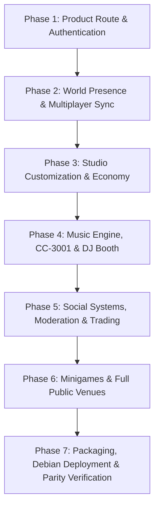

# Master Implementation Plan: 1:1 Historical Recreation of Coke Music / Coke Studios

> **Product Mandate:** Build a faithful, playable, 1:1 recreation of the historical Coke Music / Coke Studios (2002–2007) virtual world in **Go**. Fidelity encompasses the website, authentication, V-ego avatar system, isometric rooms, user interface, music composition and performance, in-game economy, minigames, social systems, and authoritative multiplayer networking. A collection of standalone prototypes, engine pickers, or a JavaScript fallback game does not satisfy this mandate.

---

## 1. Core Architectural & Platform Principles

### 1.1 Debian-First Linux Hosting & Cross-Platform Development
* **Production Environment (Debian Linux Primary):**
  - All deployment artifacts, service definitions (`coke-studios.service`), container configurations (`Dockerfile`), and compiled server binaries target **Debian GNU/Linux 12 (Bookworm)**.
  - Production uses native Linux socket primitives (epoll abstractions in standard Go runtime), POSIX signal handling (`SIGTERM`, `SIGHUP`), and standard Linux filesystem hierarchy:
    * Server Binary: `/usr/local/bin/coke-server-linux`
    * Configuration: `/etc/coke/coke.conf`
    * Web Assets & WASM: `/var/lib/coke/web/`
    * Database Storage: `/var/lib/coke/coke.db` (SQLite) or production MariaDB 10.11+ instance.
    * Systemd Service: `/etc/systemd/system/coke-studios.service`
    * Log Destination: `/var/log/coke/server.log` (managed by `logrotate`)
* **Production Systemd Service Definition (`/etc/systemd/system/coke-studios.service`):**
  ```ini
  [Unit]
  Description=Coke Studios Authoritative Virtual World Server
  After=network.target mariadb.service
  Wants=network-online.target

  [Service]
  Type=simple
  User=coke
  Group=coke
  WorkingDirectory=/var/lib/coke
  ExecStart=/usr/local/bin/coke-server-linux -config /etc/coke/coke.conf
  Restart=on-failure
  RestartSec=5s
  LimitNOFILE=65535
  StandardOutput=journal
  StandardError=journal
  SyslogIdentifier=coke-studios
  KillSignal=SIGTERM
  TimeoutStopSec=15s

  [Install]
  WantedBy=multi-user.target
  ```
* **Production Configuration File Template (`/etc/coke/coke.conf`):**
  ```ini
  # Coke Studios Server Configuration
  http_bind="0.0.0.0:8080"
  public_origin="https://cokestudios.example.com"
  db_type="mariadb" # or "sqlite"
  db_dsn="coke_user:SecretPassword@tcp(127.0.0.1:3306)/coke_studios?parseTime=true&charset=utf8mb4"
  sqlite_path="/var/lib/coke/coke.db"
  web_dir="/var/lib/coke/web"
  max_clients=2000
  rate_limit_messages_per_sec=3
  log_level="info"
  ```
* **Development Environment (Windows Compatible):**
  - Tooling maintains complete parity with Windows 10/11 development workstations (`tools/build-go.ps1` and `.cmd` wrappers mirror `.sh` scripts) without compromising the Debian production standard.
* **Pure Go Authoritative Core:**
  - **Server:** Written in standard Go (`go 1.26.x`), authoritative over all game state, sessions, room occupancy, collision, trades, CD burns, DJ queues, and economic balances.
  - **Client:** Written in Go utilizing **Ebitengine** (`v2.8.x`), compiled to WebAssembly (`GOOS=js GOARCH=wasm`) to render directly onto an HTML5 `<canvas>` at the historical logical stage resolution ($760 \times 520$).
  - **Unified Origin Architecture:** A single Go HTTP/WebSocket server hosts the public web portal, serves static assets and the compiled WASM binary, handles REST/AMF endpoints, and terminates realtime game sockets.

---

## 2. System Architecture & Topology

```
+--------------------------------------------------------------------------------------------------+
|                                    UNIFIED GO SERVER (Debian)                                    |
|  +--------------------+  +----------------------+  +---------------------+  +-----------------+  |
|  | HTTP & Static Host |  | Session Auth & DB    |  | Realtime Socket Hub |  | DJ & Audio Sync |  |
|  | (760px Web Portal) |  | (SQLite / MariaDB)   |  | (Rooms & Movement)  |  | (Authoritative) |  |
|  +---------+----------+  +----------+-----------+  +----------+----------+  +--------+--------+  |
+------------|------------------------|-------------------------|----------------------|-----------+
             |                        |                         |                      |
             v                        v                         v                      v
+--------------------------------------------------------------------------------------------------+
|                                     CLIENT BROWSER RUNTIME                                       |
|  +-------------------------------------+  +---------------------------------------------------+  |
|  | 760px Authentic Website Shell       |  | Go / Ebitengine WebAssembly Client                |  |
|  | - 176px Live Isometric Avatar Badge |  | - 760x520 Macromedia Director Stage Resolution    |  |
|  | - 584px Historical Sliced Nav Strip |  | - IsoEngine (Pathfinding, Occlusion & Stacking)   |  |
|  | - 5-Step Denizen Registration Form  |  | - CC-3001 5-Slot Music Mixer & Sequencer Engine   |  |
|  | - Direct Launch to WASM Viewport    |  | - DJ Turntables, Room Chat & Multi-client Furni   |  |
|  +-------------------------------------+  +---------------------------------------------------+  |
+--------------------------------------------------------------------------------------------------+
```

---

## 3. Feature-by-Feature Detailed Specification: How It Functioned vs. How It Should Function

---

### Feature 1: Website Shell, Portal & Authentication Journey

#### A. How It Functioned Historically
1. **Layout & Geometry:**
   - The website operated on a strict 760px total width matching the Director MX stage width.
   - **Left Column (176px - 180px):** Contained the V-Ego status badge (`badge.swf`), featuring a live rotating isometric avatar on a gold podium, online status indicator, DJ handle, custom mission statement, Decibel (dB) wallet meter, and V-Coins balance.
   - **Top Navigation Strip (584px wide, 26px high):** Sliced navigation bar containing 8 authentic tabs:
     * `Home` (50px wide) $\rightarrow$ News, artist highlights, community features.
     * `CokeStudios` (92px wide) $\rightarrow$ Direct game launch modal or embedded Shockwave viewport.
     * `Games` (65px wide) $\rightarrow$ Minigames portal (Sumo, Uncover the Music, Pop Quiz).
     * `Music-Mixer` (87px wide) $\rightarrow$ Web music mixer intro and "Create Your Demo" launcher.
     * `Music` (53px wide) $\rightarrow$ Coke FM streaming player, track listings, and artist charts.
     * `Decibel Central` (107px wide) $\rightarrow$ Earning guides, promotions, and SMS code redemption.
     * `Downloads` (83px wide) $\rightarrow$ AIM icons, desktop wallpapers, MP3s, screensavers.
     * `Help` (47px wide) $\rightarrow$ FAQ, Music Pass details, and feedback submission ($380 \times 320$).
   - Combined geometry: $176\text{px} + 584\text{px} = 760\text{px}$.
   - **Authentic Popup Windows:**
     * Game Viewport: $760 \times 520$ (`window.open(..., 'CokeStudios', 'width=760,height=520')`).
     * Postcard Preview: $510 \times 460$ (Card art, music preview, message preview).
     * Postcard Confirmation: $640 \times 480$.
     * Feedback Form: $380 \times 320$.
     * Messenger Console: $327 \times 327$.
2. **Website Services:**
   - **Virtual Postcards (`POST /servlet/PostCard`):** Allowed users to choose postcard art, attach a musical loop, enter up to 5 recipient email addresses, write a custom message, preview, and send.
   - **Music Pass:** Membership record tying a player's V-ego appearance, Decibels balance, studio ownership, and daily activity logs.
3. **Registration Flow (5-Step Wizard):**
   - *Step 1: Account Identity* (Screen name selection, email address, password, date of birth).
   - *Step 2: Gender & Baseline Look* (Male/Female base sprite set).
   - *Step 3: Hair Selection* (Hair style ID and color palette swatch).
   - *Step 4: Clothing & Face* (Face style, torso/shirt, legs/pants, shoes, and respective color palettes).
   - *Step 5: Studio Selection* (Initial free studio room layout choice: Studio Model A, B, C, or D).
4. **Persistent Room Toolbar (`62_room_bar.window.txt`):**
   - Fixed at bottom of stage ($760 \times 61$ px background; template rectangle `[0, 451, 760, 539]`):
     * `int_speechmode_speak` / `int_speechmode_shout` / `cc.speechswitch`: Toggle between normal speak and room-wide shout.
     * `chat_field`: Active text input box (Verdana Bold 10pt) for typing messages.
     * `room_info_text`: Current room title and occupancy count.
     * `room_tooltip_text`: Dynamic hover tooltip for buttons.
     * 8 Action Icons ($22 \times 22$ px): `Jukebox`, `Navigator`, `Messenger`, `Decibels`, `Backpack`, `Catalogue`, `Sound`, `Help`.

#### B. How It Should Function in the Go Remake
1. **Unified Portal Serving:**
   - The Go HTTP server directly serves the reconstructed 760px portal at `/` using semantic HTML5, CSS pixel styling, and original raster assets (`sources/gocoke/web/`).
   - The live status badge runs an isometric preview of the logged-in player's avatar using Ebitengine WASM or client-side canvas rendering matching the exact figure definition.
2. **Authoritative Registration & Identity:**
   - The 5-step registration submits to `/api/denizen/register`.
   - Passwords are authenticated using PBKDF2 with SHA-256 (or Argon2id) salt/hash.
   - The server enforces unique screen names, valid RFC-compliant emails, and legal avatar component IDs.
   - Upon completion, the server atomically creates:
     * Denizen profile in `denizens` table.
     * Initial starter studio in `studios` table based on the chosen model (1–4).
     * Starter wallet in `wallets` table initialized to the historical starting balance (100 dB).
3. **Seamless Secure Session Handoff:**
   - Authentication sets an `HttpOnly`, `SameSite=Lax` session cookie (`coke_session`) and returns an opaque session token (`sid`).
   - The client launches `/game/` running `main.wasm`. The WASM client reads `sid` directly from the environment/cookie and authenticates with the server via WebSocket without requiring manual password re-entry or insecure query strings.

---

### Feature 2: V-Ego Avatar System & Animation Engine

#### A. How It Functioned Historically
1. **Figure Definition Schema:**
   - Avatars ("V-egos") were encoded as Lingo property strings:
     `hr=001/115,75,45&hd=001/255,204,153&ch=001/204,0,0&lg=001/0,0,102&sh=001/51,51,51`
   - Component tags: `hd` (head/face), `hr` (hair), `ch` (chest/shirt), `lg` (legs/pants), `sh` (shoes).
   - Each part had a 3-digit style ID and either a legacy palette index (1–16) or an explicit RGB triple (`R,G,B`).
2. **Layering & Depth Ordering Across 8 Orientations:**
   - Avatars rendered across 8 isometric orientations ($0 = \text{North}, 1 = \text{North-East}, 2 = \text{East}, 3 = \text{South-East}, 4 = \text{South}, 5 = \text{South-West}, 6 = \text{West}, 7 = \text{North-West}$).

   | Orientation | Angle Name | Z-Order Layer Stack (Back to Front) |
   |---|---|---|
   | **0** | North | `item_held` $\rightarrow$ `hr_f` (hair front) $\rightarrow$ `hd` (head) $\rightarrow$ `ch` (shirt) $\rightarrow$ `lg` (pants) $\rightarrow$ `sh` (shoes) $\rightarrow$ `hr_b` (hair back) |
   | **1** | North-East | `item_held` $\rightarrow$ `hr_f` $\rightarrow$ `hd` $\rightarrow$ `ch` $\rightarrow$ `lg` $\rightarrow$ `sh` $\rightarrow$ `hr_b` |
   | **2** | East | `hr_b` $\rightarrow$ `sh` $\rightarrow$ `lg` $\rightarrow$ `ch` $\rightarrow$ `hd` $\rightarrow$ `hr_f` $\rightarrow$ `item_held` |
   | **3** | South-East | `hr_b` $\rightarrow$ `sh` $\rightarrow$ `lg` $\rightarrow$ `ch` $\rightarrow$ `hd` $\rightarrow$ `hr_f` $\rightarrow$ `item_held` |
   | **4** | South | `hr_b` $\rightarrow$ `sh` $\rightarrow$ `lg` $\rightarrow$ `ch` $\rightarrow$ `hd` $\rightarrow$ `hr_f` $\rightarrow$ `item_held` |
   | **5** | South-West | `hr_b` $\rightarrow$ `sh` $\rightarrow$ `lg` $\rightarrow$ `ch` $\rightarrow$ `hd` $\rightarrow$ `hr_f` $\rightarrow$ `item_held` |
   | **6** | West | `hr_b` $\rightarrow$ `sh` $\rightarrow$ `lg` $\rightarrow$ `ch` $\rightarrow$ `hd` $\rightarrow$ `hr_f` $\rightarrow$ `item_held` |
   | **7** | North-West | `item_held` $\rightarrow$ `hr_f` $\rightarrow$ `hd` $\rightarrow$ `ch` $\rightarrow$ `lg` $\rightarrow$ `sh` $\rightarrow$ `hr_b` |

3. **Animation States & Ticks:**
   - **Walk Cycle:** 4-frame walk animation cycling at approximately 12–16 Director ticks per cycle (~5.3–5.5 steps per second):
     * *Frame 0 (Tick 0):* Left leg contact, right leg trail, head neutral ($y = 0$).
     * *Frame 1 (Tick 4):* Passing stance, right leg forward swing, head bounce ($y = -1\text{px}$).
     * *Frame 2 (Tick 8):* Right leg contact, left leg trail, head neutral ($y = 0$).
     * *Frame 3 (Tick 12):* Passing stance, left leg forward swing, head bounce ($y = -1\text{px}$).
   - **Gestures:** Sitting (`sit`), Drinking Coke (`drink` with 3-frame lifting can, sipping, and lowering), Dancing (`dance` with 4 rhythm steps), Waving (`wave`), and Head nod while typing/chatting.
   - **Eye Blinking:** Uniform random interval between 3.0s and 7.0s. 2-frame blink duration (frame 1 half-closed for 80ms, frame 2 fully closed for 80ms, then restores open eyes).
4. **Color Tinting & Ink Modes:**
   - Sprites were grayscale ink masks tinted dynamically by Macromedia Director's `foreColor` / inkCopy / inkMatte modes. Tint formula:
     $$C_{\text{final}} = \frac{C_{\text{mask}} \times C_{\text{palette}}}{255}$$

#### B. How It Should Function in the Go Remake
1. **Avatar Engine Architecture (`internal/client/avatarengine`):**
   - Implements a pure Go sprite compositing pipeline using Ebitengine.
   - Normalizes figure strings via `avatar.NormalizeDefinition`, mapping legacy numeric palettes to calibrated RGB values.
   - Color tinting uses Ebitengine's `ColorM.Scale(r/255, g/255, b/255, 1.0)` against grayscale sprite masks.
   - Anchor registration points strictly match `Members.csv` to ensure hair, clothes, and accessories align seamlessly across all 8 orientations.
2. **Authoritative Appearance Protection:**
   - The server stores the authoritative `figure_definition` in the database.
   - Client socket packets cannot supply arbitrary figure strings to alter in-room appearance; the server broadcasts the stored profile definition.

---

### Feature 3: Isometric World Engine, Public Rooms & Studio Layouts

#### A. How It Functioned Historically
1. **Projection & Tile Math:**
   - Isometric diamond grid projection where step along $X$ maps to $(+\Delta x, +\Delta y)$ and step along $Y$ maps to $(-\Delta x, +\Delta y)$.
   - Tile dimensions calibrated to 32px horizontal half-width, 16px vertical half-height (standard $2:1$ isometric aspect ratio; $64 \times 32$ bounding diamond).
   - **Forward Screen Coordinate Conversion:**
     $$x_{\text{screen}} = (col - row) \times 32 + \text{Origin}_X$$
     $$y_{\text{screen}} = (col + row) \times 16 - \text{HeightOffset} + \text{Origin}_Y$$
   - **Inverse Tile Coordinate Conversion (Screen to Grid):**
     $$col = \left\lfloor \frac{\frac{x_{\text{screen}} - \text{Origin}_X}{32} + \frac{y_{\text{screen}} - \text{Origin}_Y + \text{HeightOffset}}{16}}{2} \right\rfloor$$
     $$row = \left\lfloor \frac{\frac{y_{\text{screen}} - \text{Origin}_Y + \text{HeightOffset}}{16} - \frac{x_{\text{screen}} - \text{Origin}_X}{32}}{2} \right\rfloor$$
2. **Public Rooms Catalog:**
   - Public rooms featured hand-drawn pre-rendered backgrounds with collision masks and specific walkable zones:
     * *London I & II* (Club setting with central dance floor $8 \times 6$, bar, and elevated DJ booth; layout model 5).
     * *Alaska* (Glacial ice cave with frozen pond ice-skating physics, ice igloo entrance, and DJ turntables).
     * *Miami* (Beachfront lounge with palm trees, sunbeds, cabana bar, and DJ booth on the boardwalk).
     * *Goa* (Psychedelic beach party with neon banners, sound system towers, and sand dance floor).
     * *Moscow* (Underground industrial warehouse with metallic catwalks, iron trusses, and warehouse sound stage).
     * *Mombasa* (African safari lodge with thatched roofs, wooden deck patio, and open savanna backdrop).
     * *Central Park* (Urban park with stone pathways, benches, streetlamps, trees, and outdoor music stage).
3. **Private Studios:**
   - Player-owned customizable rooms with modular wall and floor tiles:
     * *Studio Model A (1):* $8 \times 8$ compact starter space.
     * *Studio Model B (2):* $10 \times 10$ studio with entrance hallway.
     * *Studio Model C (3):* Multi-tiered split-level studio with elevation ramps.
     * *Studio Model D (4):* Large open penthouse layout.
4. **Pathfinding & Collision:**
   - Server-side 2D pathmaps with byte weights: `0` = Walkable, `255` = Blocked/Wall, values in between represent height offsets.
   - Pathfinding implemented using Breadth-First Search (BFS) or $A^*$ yielding an array of grid coordinates.

#### B. How It Should Function in the Go Remake
1. **Unified Coordinate Contract:**
   - Client and server strictly use `(col, row)` grid space mapped to screen space.
   - Screen depth sorting orders sprites by:
     $$\text{Depth} = (col + row) \times 1000 + z_{\text{sublayer}}$$
2. **Server-Authoritative Movement Lifecycle:**
   - Client sends destination request: `<AV_GSP roomID="..."><P x="col" z="row"/></AV_GSP>`.
   - The server validates that:
     * Destination is inside room bounds and has a walkable weight (`!= 255`).
     * Destination is not currently occupied by another avatar or blocking furniture.
   - Server calculates the path using $A^*$ and broadcasts: `<AV_MV av="DenizenID" x="col" z="row"/>`.
   - Client performs local path interpolation with dead reckoning and snaps to server updates on arrival.
3. **Room Transitions & State Cleanup:**
   - Exiting a room sends `<Room.Exit/>`. Server broadcasts `<AV_RM av="DenizenID"/>` to all remaining occupants before unregistering the player.
   - Changing rooms validates destination rights before removing presence from the current room to prevent avatar loss.

---

### Feature 4: Realtime Multiplayer Protocol & Network Topology

```
Client Alice (WASM)                Authoritative Go Server                 Client Bob (WASM)
        |                                     |                                    |
        |--- WebSocket Connect -------------->|                                    |
        |--- <Login ticket="..."/> ---------->|                                    |
        |<-- <Accepted/> ---------------------|                                    |
        |                                     |                                    |
        |--- <Room.Enter roomID="London"/> -->|                                    |
        |<-- <Accepted/> ---------------------|                                    |
        |<-- <ST_EN layout="5" .../> ---------|                                    |
        |<-- <AV av="Bob" x="12" z="14".../> -|                                    |
        |                                     |--- <AV av="Alice" x="5" z="5"...-->|
        |                                     |                                    |
        |--- <AV_GSP><P x="8" z="8"/></AV_GSP>|                                    |
        |    (Server runs A* validation)      |                                    |
        |<-- <AV_MV av="Alice" x="8" z="8"/> -|--- <AV_MV av="Alice" x="8" z="8"->|
        |                                     |                                    |
        |--- <CH text="Hey Bob!" mode="1"/> ->|                                    |
        |<-- <CH av="Alice" m="486579..."/> --|--- <CH av="Alice" m="486579..."/>->|
```

#### A. Comprehensive Protocol Grammar Reference Table

| Packet Identifier | Dir | Payload / Attributes | Historical Purpose & Server Semantics |
|---|---|---|---|
| `<Login>` | C $\rightarrow$ S | `username="..." ticket="..." msgID="1"` | Authenticates connection against persistent session ticket (`sid`). |
| `<Accepted>` | S $\rightarrow$ C | `[roomID="..."]` | Acknowledges successful authentication or room entry. |
| `<Alert>` | S $\rightarrow$ C | `msg="..."` | Displays standard modal alert dialog to user. |
| `<Room.Enter>` | C $\rightarrow$ S | `roomID="..." [password="..."]` | Requests admission to public room or private studio. |
| `<Room.Exit>` | C $\rightarrow$ S | `[roomID="..."]` | Gracefully leaves room; triggers presence cleanup. |
| `<ST_EN>` | S $\rightarrow$ C | `layout="..." name="..." owner="..." wp="..." fl="..." db="..."` | Studio environment setup: background, dimensions, and decor settings. |
| `<AV>` | S $\rightarrow$ C | `av="..." x="..." z="..." d="..." act="..." cr="..." fd="..."` | Avatar presence element (initial snapshot or entrant broadcast). |
| `<AV_MV>` | S $\rightarrow$ C | `av="..." x="..." z="..." d="..."` | Authoritative avatar movement interpolation step. |
| `<AV_GSP>` | C $\rightarrow$ S | `<P x="..." z="..."/>` | Client movement request to destination grid coordinate $(x, z)$. |
| `<AV_RM>` | S $\rightarrow$ C | `av="..."` | Removes avatar sprite from room presence on departure. |
| `<CH>` (Client) | C $\rightarrow$ S | `text="..." mode="0\|1\|2"` | Submits chat message ($0=\text{whisper}, 1=\text{chat}, 2=\text{shout}$). |
| `<CH>` (Server) | S $\rightarrow$ C | `av="..." m="<hex_text>" mode="..."` | Broadcasts chat message to in-range players in room. |
| `<POS>` | S $\rightarrow$ C | `id="..." cid="..." x="..." y="..." z="..." d="..."` | Placed furniture snapshot element on room entrance. |
| `<POS_MV>` | C $\rightarrow$ S | `id="..." x="..." y="..." z="..." d="..."` | Requests moving or rotating placed furniture. |
| `<POS_RM>` | C $\rightarrow$ S | `id="..."` | Picks up placed furniture back into backpack inventory. |
| `<ST_KICK>` | C $\rightarrow$ S | `target="..."` | Studio owner ejects unwanted visitor. |
| `<KICKED>` | S $\rightarrow$ C | `roomID="..." by="..."` | Informs kicked client to tear down room and return to Navigator. |
| `<ST_KNOCK>` | S $\rightarrow$ C | `av="..."` | Alerts studio owner that a visitor is ringing the doorbell. |
| `<DB_R>` | C $\rightarrow$ S | `target="..." allow="0\|1"` | Owner admits (`1`) or denies (`0`) knocking visitor. |
| `<ST_DECOR>` | S $\rightarrow$ C | `wp="..." fl="..." db="..."` | Realtime broadcast of changed wallpaper, floor, or doorbell state. |
| `<MIX_SAVE>` | C $\rightarrow$ S | `slot="..." title="..." edl="..."` | Saves mix sequence to slot 1–5 in `saved_mixes` table. |
| `<CD_BURN>` | C $\rightarrow$ S | `slot="..." title="..." edl="..."` | Consumes Blank CD or 10 dB to mint unique CD in `cds` table. |
| `<CD_P>` | S $\rightarrow$ C | `cdID="..." songID="..." length="..."` | Broadcasts song start on DJ turntables to all room occupants. |
| `<CD_VR>` | S $\rightarrow$ C | `cdID="..." elapsed="..."` | Provides seek offset (ms) for late entrants entering during performance. |
| `<CD_END>` | S $\rightarrow$ C | `[cdID="..."]` | Concludes performance, unmounts DJ, and rotates FIFO queue. |
| `<VOTE>` | C $\rightarrow$ S | `val="1\|-1"` | Submits listener rating (Thumbs Up / Down) during DJ performance. |
| `<TRADE_REQ>` | C $\rightarrow$ S | `target="..."` | Initiates trade request with target player in room. |
| `<TRADE_INV>` | S $\rightarrow$ C | `from="..."` | Displays trade invitation dialog to target player. |
| `<TRADE_ACC>` | C $\rightarrow$ S | `target="..."` | Accepts trade invitation; triggers window open. |
| `<TRADE_START>` | S $\rightarrow$ C | `with="..."` | Opens $340 \times 218$ trade window on both clients. |
| `<TRADE_OFFER>` | C $\rightarrow$ S | `items="[id1, id2, ...]"` | Places up to 6 items from backpack into trade offer. |
| `<TRADE_UPDATE>` | S $\rightarrow$ C | `av="..." items="[...]"` | Synchronizes partner's offer slots in real time. |
| `<TRADE_CONFIRM>` | C $\rightarrow$ S | `[none]` | Locks offer and marks player agreement. |
| `<TRADE_RESET>` | S $\rightarrow$ C | `[none]` | Resets confirmation lock if either party alters their offer. |
| `<TRADE_COMPLETE>` | S $\rightarrow$ C | `[none]` | Commits atomic SQL possession swap; closes trade window. |
| `<TRADE_CANCEL>` | C $\rightarrow$ S | `[none]` | Aborts trade session immediately; restores all items to backpacks. |
| `<DRINK_COKE>` | C $\rightarrow$ S | `[none]` | Triggers Coke vending machine dispense, drinking anim, and dB award. |

#### B. How It Should Function in the Go Remake
1. **WebSocket Framing (`net/realtime`):**
   - Realtime networking uses standard WebSockets over TLS (`/ws/realtime`), natively supported by browser WASM and Go servers.
   - Maintains exact historical XML payload grammar to preserve client compatibility.
2. **Actor-Based Room Concurrency (`cmd/server/rooms.go`):**
   - Each active room runs as an isolated actor managed via goroutine message channels or fine-grained read/write mutexes.
   - **Snapshot & Admission Atomicity:** When an entrant joins, the server locks room presence, captures an immutable snapshot of all present avatars and furniture, adds the entrant, releases the lock, and broadcasts the entrant to existing players while dispatching the snapshot to the entrant.
   - **Stable Connection Identity:** Separates socket connection UUID (`Player.ID`) from database identity (`Player.DenizenID`) to prevent pointer aliasing and race conditions on reconnect.

---

### Feature 5: Chat Engine, Speech Bubbles, Host Controls & Doorbell Protocol

```
Visitor (WASM)                       Authoritative Go Server                     Host Owner (WASM)
      |                                         |                                       |
      |--- <Room.Enter roomID="Priv123"/> ----->|                                       |
      |    (Studio is Locked: Doorbell == 1)    |                                       |
      |<-- <Alert msg="Doorbell ringing..."/>---|                                       |
      |                                         |--- <ST_KNOCK av="Visitor"/> --------->|
      |                                         |    (HUD displays admit/deny dialog)   |
      |                                         |<-- <DB_R target="Visitor" allow="1"/>-|
      |<-- <Accepted/> -------------------------|                                       |
      |<-- <ST_EN layout="1" .../> -------------|                                       |
```

#### A. How It Functioned Historically
1. **Chat Modes & Speech Bubbles:**
   - **Whisper (`mode=0`):** Target player only; text enclosed in parentheses; visible only to sender and recipient within hearing distance.
   - **Normal Chat (`mode=1`):** Standard speech bubble above avatar head; heard within a ~9-tile radius.
   - **Shout (`mode=2`):** Bold uppercase text bubble; heard room-wide; causes avatar head to tilt upwards.
   - Speech bubbles rendered using 9-slice scalable frames with a downward pointing tail aimed at the avatar's mouth. Bubbles floated upwards when new messages were sent and faded after 5.0 seconds.
2. **Studio Host Controls & Moderation:**
   - In private studios, the room owner possessed moderation controls accessible via avatar context menu or room settings:
     * **Kick Out (`<ST_KICK target="DenizenID"/>`):** Instantly ejects the target avatar from the studio, sending `<KICKED roomID="..." by="Owner"/>` and returning the visitor to the Navigator.
     * **Room Access Modes:** Open (anyone enters), Password Protected (requires entering password in `nav_input_password.window`), and Doorbell Locked (knocking required).
3. **The Doorbell Knocking Protocol:**
   - When a visitor attempts to enter a locked studio (`doorbell_locked = 1`), entry is held.
   - Visitor client displays waiting window (`nav_ringbell.window`).
   - Server broadcasts `<ST_KNOCK av="VisitorScreenName"/>` to the studio room.
   - The owner's client opens an admit/deny decision window (`sanfo_decision`).
   - If the owner clicks "Let In", client sends `<DB_R target="Visitor" allow="1"/>`. The server admits the visitor with `<Accepted/>` and `<ST_EN>`.
   - If the owner clicks "Deny", client sends `<DB_R target="Visitor" allow="0"/>`. The server sends `<Alert msg="The owner did not let you in."/>` to the visitor and cancels entry.
4. **Access-Control Window Dialogs (`cc_navigator[1]`):**
   - `16_nav_input_password.window.txt`: Displays password field (`nav_flatpassword_field`), OK (`nav_flatpassword_ok_button`), and Cancel (`nav_flatpassword_cancel_button`).
   - `19_nav_dooropens.window.txt`: Visual feedback for successful admission, displaying `door_open` bitmap ($31 \times 42$) with `nav_dooropens` and `nav_loading` labels.
   - `20_nav_doornotopens.window.txt`: Visual feedback for door refusal or host timeout, displaying `door_closed` bitmap ($31 \times 42$), `nav_noanswer` label, and `nav_noanswer_ok_button` returning to Navigator.
5. **Infostand Context Menu:**
   - Clicking an avatar in a room opened the Infostand context menu with action tags:
     `Kick Out`, `Move`, `Trade`, `Ask to become a friend`, `Rotate`, `Pick up`, `Delete`, `Dance`.

#### B. How It Should Function in the Go Remake
1. **Chat Engine Implementation (`internal/client/scene/studio/chat.go`):**
   - Pure-Go 9-slice speech bubble renderer with exact Director font metrics (Verdana Bold 10pt).
   - Dynamic vertical stacking: when an avatar chats rapidly, prior bubbles smoothly slide upward by 18px.
   - Server validates rate limits (max 3 messages per 2 seconds; 10-second mute on violation) and enforces Euclidean distance attenuation.
2. **Authoritative Moderation & Doorbell Engine (`cmd/server/social.go`):**
   - Server validates room ownership before processing any `<ST_KICK>` or `<DB_R>` packet.
   - When kicked, client receives `<KICKED>` and gracefully transitions back to Navigator with an alert dialog.
   - Doorbell state machine handles timeouts: if the owner does not respond within 30 seconds, the knocking session expires automatically with a timeout notification.

---

### Feature 6: Music Creation, CC-3001 Mixer & Sequencer Engine

```
+--------------------------------------------------------------------------------------------------+
|                                    CC-3001 MUSIC MIXER & SEQUENCER                              |
|                                                                                                  |
| [In-Game CC-3001 Mixer Window] (6_cc_mixer.window.txt)                                           |
| +----------------------------------------------------------------------------------------------+ |
| | Slot 1: "Neon Sunset"      [Play] [Edit] [Burn CD]                                            | |
| | Slot 2: "Electro Groove"    [Play] [Edit] [Burn CD]                                            | |
| | Slot 3: "Hip-Hop Beats"     [Play] [Edit] [Burn CD]                                            | |
| | Slot 4: [Empty Slot]        [Play] [Edit] [Burn CD]                                            | |
| | Slot 5: [Empty Slot]        [Play] [Edit] [Burn CD]                                            | |
| +----------------------------------------------------------------------------------------------+ |
|        |                               |                                      |                  |
|        v (Play)                        v (Edit)                               v (Burn CD)        |
| [Play via Local Stereo]        [Open Sequencer Editor]                [Trigger CD Minting Flow]  |
|                                (4-Track 16-Bar Timeline)              (Requires Blank CD)        |
+--------------------------------------------------------------------------------------------------+
```

#### A. How It Functioned Historically
1. **The CC-3001 Deluxe Station:**
   - Interacting with the CC-3001 furniture item (or bottom toolbar) opened `6_cc_mixer.window.txt` ($760 \times 520$).
   - Managed exactly 5 saved mix slots.
   - Each slot displayed: Track Title, Play button, Edit button, Burn to CD button.
   - Missing/empty slots displayed `[Empty]` and disabled Play/Burn controls.
2. **The Sound Library (`94_SoundLibraryData.txt`):**
   - 7 authentic musical categories:
     * `Country` (e.g. 4x4, Bluegrass, Bluesy, Slide Guitar, Fiddle/Banjo, Country Vocals).
     * `Dance` (e.g. Daft, Electro, Magpie, Sonar Pole, Synth 1 & 2, Dance Tech, Dance Vocals).
     * `Hip-Hop` (e.g. Downtown, Rakim, Red Alert, Rico, Skee, Slinky, Hip Hop Keys & Beats).
     * `Latin` (e.g. Bells, Congas, Horns, Maracas, Piano, Saxophone, Latin Guitars).
     * `Misc` (e.g. Asian Strings, Cow Bell, Detroit, Scratches, Funky Bass, Harmonica, Shakers).
     * `Pop` (e.g. Breakbeat, Bumble Bee, Cop Show, YMCA, Pop Guitars, DrumBass).
     * `Rock` (e.g. Big Beats, Crash, Danger, Hanoi, Marco, Polo, Rock Guitars, Heavy Riffs).
   - Audio loops: 16-bit 44.1kHz PCM WAV loops subdivided into 2, 4, 8, or 16 beats.
3. **The Sequencer / Timeline Structure:**
   - 4 parallel audio tracks:
     * *Track 1:* Drums / Percussion
     * *Track 2:* Basslines
     * *Track 3:* Melodic Synthesizers / Keys
     * *Track 4:* Vocal Stabs / Sound FX
   - 16 musical bars, subdivided into 16 steps per bar at standard tempos (120–135 BPM).
4. **Data Representation (OddCast Event Decision List - EDL):**
   - Mixes saved as structured text/EDL strings mapping loop sample IDs to track indices and bar offsets:
     `v=1&bpm=128&t1=101:0,102:4,101:8&t2=201:0,201:8&t3=305:0&t4=402:12`
   - In Director, clicking "Edit" paused the game interface (`43_paused.window.txt`), obtained a session URL, and launched `javascript:openMixer(...)` to open the OddCast Flash mixer (`am_habbo_v2.swf`) in a popup window. Upon saving, the popup closed and the in-game slot refreshed.

#### B. How It Should Function in the Go Remake
1. **Unified Pure-Go Sequencer (`internal/client/scene/studio/mixer.go`):**
   - Full timeline sequencing implemented natively in Go; eliminates external Flash dependencies while preserving full compatibility with historical OddCast EDL formats.
   - Realtime audio synthesis driven by Ebitengine WebAudio context (`audio.NewContext(44100)`).
   - Dynamically mixes 4 tracks of 16-bit 44.1kHz PCM WAV loops from `web/Lingo/soundlibrary/` with per-track volume faders, mute/solo toggles, and loop preview.
2. **Audio Buffer Mixing Pipeline:**
   - Implements a procedural PCM stream (`io.Reader`) feeding Ebitengine's audio player:
     $$\text{Sample}_{\text{mixed}}[i] = \text{clamp}\left(\sum_{t=1}^{4} \text{Track}_t[i] \times \text{Gain}_t, -32768, 32767\right)$$
   - Bar scheduling aligns playback to 16-step subdivisions ($dt = \frac{60}{\text{BPM} \times 4}\text{ seconds}$).
3. **Authoritative Storage & API:**
   - Mixes saved via `POST /api/music/save` or realtime `<MIX_SAVE slot="..." title="..." edl="..."/>`.
   - Server validates slot index ($1 \le \text{slot} \le 5$), title length (max 32 chars), and legal loop IDs before updating `saved_mixes` table.

---

### Feature 7: CD Burning, DJ Booth & Room Performances

```
+--------------------------------------------------------------------------------------------------+
|                                    CD BURNING & DJ LIFECYCLE                                     |
|                                                                                                  |
| [Backpack: Blank CD]  --->  [CC-3001 Burn Mix]  --->  [Server Validates & Consumes Blank CD]      |
|                                                                    |                             |
|                                                                    v                             |
| [Room DJ Booth Queue] <---  [New Owned CD Item] <---  [Mints Unique CD Record in DB]             |
|          |                                                                                       |
|          v                                                                                       |
| [Player Mounts Turntable]                                                                        |
|          |                                                                                       |
|          v                                                                                       |
| [Server Broadcasts <CD_P> Performance Packet & Starts Track Timer]                                |
|          |                                                                                       |
|          +---> Occupants Hear Synchronized Audio Stream via Local Sequencer                      |
|          |                                                                                       |
|          +---> Late-Joining Players Receive Elapsed Time Offset & Seek Accurately                |
|          |                                                                                       |
|          v                                                                                       |
| [Performance Finishes] ---> [Listener Voting Settles] ---> [Decibel Rewards & Top 40 Updates]   |
+--------------------------------------------------------------------------------------------------+
```

#### A. How It Functioned Historically
1. **The CD Minting Loop:**
   - Players purchased a "Blank CD" (catalog item 26) from the catalogue for Decibels.
   - In the CC-3001 mixer, pressing "Burn" opened `41_burn_decision.window.txt` displaying:
     `"Burning this mix will consume 1 Blank CD. You currently have %COUNT% Blank CDs."`
   - If player had 0 Blank CDs: alerted `ALERT_NO_BLANK_CDS` (or offered to burn for a direct fee of 10 Decibels).
   - Confirming burned the mix into an immutable, playable CD item in the backpack holding: Title, Creator ScreenName, Song ID, Duration, and EDL data.
2. **The DJ Turntable & Queue:**
   - Public rooms (London, Alaska, etc.) and private studios contained DJ Turntables.
   - Stepping onto or clicking the DJ booth joined the FIFO DJ Queue.
   - When a player reached the front of the queue, the DJ selection window opened displaying all owned CDs in the backpack.
   - Selecting a CD mounted the player on the turntables, animating the avatar into the scratching stance (`cr=scratch`).
3. **Synchronized Performance:**
   - Server broadcast song start: `<CD_P cdID="..." songID="..." length="..."/>`.
   - Every player in the room played the music tracks in sync through their local sequencer.
   - Late-joining players received `<CD_VR ... elapsed="..."/>` and seeked their sequencer to the exact playback second.
   - Song concluded authoritatively when duration elapsed: server broadcast `<CD_END/>`, ejected DJ, and prompted the queue.

#### B. How It Should Function in the Go Remake
1. **Atomic Burn Transaction (`cmd/server/main.go` & `cmd/server/music.go`):**
   - Server verifies denizen owns a Blank CD (`item_id = 26`).
   - If owned: 0 dB fee charged, decrements Blank CD count from `possessions`.
   - If not owned: deducts 10 dB fee from `wallets`. If balance $< 10\text{ dB}$, rejects with HTTP 402 / realtime alert.
   - Inserts new minted record into `cds` table with unique ID and copies the EDL sequence.
2. **Authoritative Performance State Machine:**
   - Room actor manages a FIFO DJ queue: `[]DenizenID`.
   - When active, server tracks `StartTime = time.Now()`, `Duration = song.Duration`.
   - On late join, server sends current playback offset: $\Delta t = \text{now} - \text{StartTime}$. Client starts audio playback at offset $\Delta t$.
   - Song terminates authoritatively when timer expires; server ejects DJ and advances the queue.

---

### Feature 8: Voting, Reputation, Decibels & Top 40 Charts

#### A. How It Functioned Historically
1. **Voting Mechanics:**
   - During a performance, listeners received a voting widget on the HUD (`65_vote_interface.window.txt`):
     * **Thumbs Up (Upvote):** $+1$ approval.
     * **Thumbs Down (Downvote):** $-1$ disapproval.
     * **Abstain:** No vote cast.
   - Voting was permitted only after listening for a minimum duration (at least 15–20 seconds).
   - Self-voting by the active DJ was strictly prohibited.
2. **Payout Formulas & Decibels:**
   - At track conclusion, the DJ received Decibels based on net positive votes ($V_{\text{up}} - V_{\text{down}}$) and listener count:
     $$\text{Reward}_{\text{DJ}} = \max(0, V_{\text{up}} - V_{\text{down}}) \times 2 + \text{BaseBonus}$$
   - Active voters received a participation reward (2–5 dB).
3. **Top 40 Charts:**
   - Daily and weekly charts ranked songs by performance count and net positive votes.
   - Displayed in-game and on the website's Launching Pad.

#### B. How It Should Function in the Go Remake
1. **Authoritative Vote Ledger:**
   - Server records votes in memory during performance: `map[DenizenID]VoteType`.
   - Prevents duplicate votes, votes from unauthenticated accounts, or votes from players who entered the room with less than 15 seconds remaining.
2. **Settlement & Anti-Exploit Enforcement:**
   - Computes rewards using deterministic rules.
   - Updates denizen wallet balances atomically via SQL `UPDATE wallets SET balance = balance + ? WHERE denizen_id = ?`.
   - Appends performance record to `song_plays` table to drive dynamic Top 40 chart calculations:
     $$\text{ChartScore} = (V_{\text{up}} - V_{\text{down}}) \times 10 + \text{PlayCount} \times 2$$

---

### Feature 9: Economy, Catalogue, Backpack & Studio Customization (Furni)

#### A. Comprehensive Furniture & Catalogue Taxonomy

| Catalog Category | Prod ID Range | Geometry / Footprint | Rotation States | Special Interactions |
|---|---|---|---|---|
| **Chairs & Sofas** | 1–25 | $1 \times 1$ or $1 \times 2$ | 4 dirs ($0, 2, 4, 6$) | Click to sit; snaps avatar position, height, and orientation. |
| **Tables & Surfaces** | 26–50 | $1 \times 1$ or $2 \times 2$ | 4 dirs ($0, 2, 4, 6$) | Stacking surface: allows other items to sit atop with height offset (`ho`). |
| **Electronics & Music** | 51–75, 88 | $1 \times 1$ or $2 \times 2$ | 4 dirs ($0, 2, 4, 6$) | CC-3001 Mixer (`prodId 88`), Stereo Jukeboxes (plays saved CDs). |
| **Coke Branded Items** | 76–84 | $1 \times 1$ or $1 \times 2$ | 4 dirs ($0, 2, 4, 6$) | Coke Vending Machine: dispenses Coke cans, triggers drinking animation, awards dB. |
| **Sumo Martial Prizes**| 85–87 | $1 \times 1$ or $2 \times 2$ | 4 dirs ($0, 2, 4, 6$) | Tatami Mat (85), Rice Paper Divider (86), Ceremonial Gong (87). |
| **Wall Decor & Posters**| 90–120 | Wall mount | 2 dirs (North / West) | Snaps to interior studio walls without blocking floor pathfinding. |
| **Flooring & Wallpaper**| Textures 1–16| Room surface | N/A | Changes room-wide tile textures via `<ST_DECOR wp="..." fl="..." db="..."/>`. |

#### B. How It Should Function in the Go Remake
1. **Atomic Economic Transactions (`cmd/server/economy.go`):**
   - Purchasing an item validates that wallet balance $\ge \text{price}$.
   - Deducts balance and inserts into `possessions` in a single SQL transaction.
2. **Grid Geometry & Anchor Inversion Fix (`internal/client/scene/studio/pos_furni.go`):**
   - Strict mathematical anchor mapping for $2 \times 2$ furniture:
     The origin tile $(col, row)$ is consistently defined across all 4 rotation states without offset drift on re-entry.
   - Stacking heights (`ho`) are authoritatively computed and enforced by the server pathmap.
3. **Collision Map Updates:**
   - When furniture is placed, moved, or picked up, the server marks the affected grid tiles as blocked (`weight = 255`) or restored (`weight = 0`).

---

### Feature 10: Social Systems: Messenger, Friends List & Trade

```
Alice (WASM)                           Authoritative Go Server                           Bob (WASM)
     |                                            |                                           |
     |--- <TRADE_REQ target="Bob"/> ------------->|                                           |
     |                                            |--- <TRADE_INV from="Alice"/> ------------>|
     |                                            |<-- <TRADE_ACC target="Alice"/> -----------|
     |<-- <TRADE_START/> -------------------------|--- <TRADE_START/> ----------------------->|
     |                                            |                                           |
     |    (Both players place items in 6 slots)   |                                           |
     |--- <TRADE_OFFER items="[101, 102]"/> ----->|                                           |
     |                                            |--- <TRADE_UPDATE av="Alice" items="..."/>>|
     |<-- <TRADE_UPDATE av="Bob" items="..."/> ---|<-- <TRADE_OFFER items="[205]"/> ----------|
     |                                            |                                           |
     |--- <TRADE_CONFIRM/> ---------------------->|                                           |
     |    (Alice confirms; Bob modifies offer)    |                                           |
     |                                            |<-- <TRADE_OFFER items="[205, 206]"/> -----|
     |<-- <TRADE_RESET/> (Alice unconfirmed!) ----|--- <TRADE_RESET/> ----------------------->|
     |                                            |                                           |
     |--- <TRADE_CONFIRM/> ---------------------->|--- <TRADE_CONFIRM/> --------------------->|
     |    (Both confirmed simultaneously)         |                                           |
     |    [Server executes atomic SQL swap]       |                                           |
     |<-- <TRADE_COMPLETE/> ----------------------|--- <TRADE_COMPLETE/> -------------------->|
```

#### A. How It Functioned Historically
1. **The Messenger Console ($327 \times 327$ Template):**
   - 6 recovered Director definitions under `cc_messenger[1]`:
     * `10_console_myinfo.window.txt` (29 elements): Own profile, mission statement, status, Decibel count (`console_myinfo_name`, `console_myhead_image`, `console_myinfo_mission_field`, `console_myinfo_messages_link`, `console_myinfo_requests_link`, `console.myfriends.button`).
     * `11_console_getmessage.window.txt` (20 elements): Received instant message view with reply and next buttons.
     * `12_console_getrequest.window.txt` (29 elements): Friend request view with Accept/Decline action handlers (`console_friendrequest_accept`, `console_getfriendrequest_reject`, `console_getrequest_sanfo_name_text`).
     * `13_console_friends.window.txt` (31 elements): Friends list showing online status, current studio location, remove friend, and compose shortcuts (`console_friends_friendlist`, `friendlist_scrollbar`, `messenger_friends_remove_button`, `messenger_friends_compose_button`).
     * `14_console_compose.window.txt` (21 elements): Compose instant or offline message (`console_compose_recipients`, `console_compose_lenght_text`, `console_compose_message_field`, `console_compose_cancel`, `console_compose_send`).
     * `15_console_removefriend.window.txt` (20 elements): Confirmation to remove friend from list.
2. **Player-to-Player Trading Window (`43_sanfo_trading.window.txt`):**
   - Opened $340 \times 218$ window (`[208, 178, 548, 396]`) with 6 item slots per player:
     * Local player slots: `trading_mystuff_1` through `trading_mystuff_6` ($40 \times 40$ px each).
     * Partner slots: `trading_herstuff_1` through `trading_herstuff_6` ($40 \times 40$ px each, 60% blend).
     * Agreement checkboxes: `trading_confirm_check` (local) and `trading_buddycheck_image` (partner).
     * Controls: `trading_cancel` (Cancel button and closebox), `trading_disclaimer_textlink` (Scam warning text in `#CC0033`).
   - **Two-Step Verification:**
     * *Step 1: Offer Phase:* Both players drag items into their respective slots.
     * *Step 2: Confirmation Phase:* Once both offer, both must press "Accept". Modifying an offer immediately resets both players' acceptance to prevent switch-tricks.
   - Transferred ownership of all offered items simultaneously.

#### B. How It Should Function in the Go Remake
1. **Persistent Social State (`cmd/server/social.go`):**
   - Friendships stored in `friendships` table (`denizen_id_1`, `denizen_id_2`, `status`).
   - Server broadcasts online/offline events to mutual friends over active WebSockets.
   - Offline messages stored in `offline_messages` table and delivered upon login.
2. **Atomic Trade Engine (`cmd/server/trade.go`):**
   - Active trade managed by server trade session actor.
   - Any modification by either party invalidates `accepted` flags.
   - Final completion transfers items between denizens within an isolated database transaction:
     ```sql
     BEGIN TRANSACTION;
     UPDATE possessions SET owner_id = ? WHERE id IN (?);
     UPDATE possessions SET owner_id = ? WHERE id IN (?);
     COMMIT;
     ```
   - If either client disconnects before final commit, the trade aborts immediately and all items remain with original owners.

---

### Feature 11: Minigames Engine (Uncover the Music, V-Ego San Sumo, Pop Quiz)

#### A. How It Functioned Historically
1. **Uncover the Music (Official Rules from `RevealChallengeRules.htm`):**
   - **Entry:** Registered MyCoke account; join a room after viewing occupants.
   - **Players:** Minimum 3, maximum 5 players.
   - **Game Start:** First entrant chooses when to start; 30-second decision period after at least 3 players are present.
   - **Turn Order:** First player chosen randomly; play proceeds counterclockwise.
   - **Board Layout:** 24 squares arranged in a grid:
     * 11 matching pairs of musical loops (22 cards total).
     * 1 Wild Card (matches any revealed card; removed on first reveal).
     * 1 Pass Card (if chosen first, forfeits turn; if chosen second, turn ends immediately and first card stays face-down).
   - **Turn Execution:** Up to 2 tile selections within 15 seconds; incomplete selection forfeits the turn.
   - **Match Resolution:** Matching pattern and music loop awards 1 Decibel, removes matched tiles, and grants the same player an extra turn.
   - **Game Conclusion:** All pairs matched.
   - **Winner Bonus:** Player with the most matched pairs receives an additional 60-Decibel bonus. In case of a tie, the 60 Decibels are shared equally among tied leaders.
   - **Dropouts:** If dropouts reduce players to fewer than 3, the game terminates immediately. Earned Decibels are credited, but no 60 dB bonus is awarded.
   - **Daily Cap:** 300 Decibels per day (midnight to 11:59 PM).
2. **V-Ego San Sumo:**
   - Turn-based tactical mini-game played on a dohyo mat against Master Kenji AI or another player.
   - **The 5 Authentic Moves:**
     * `Head Hit` (1)
     * `Body Blaster` (2)
     * `Overhead Toss` (3)
     * `Flying Kick` (4)
     * `Flying Punch` (5)
   - **Move Resolution Interaction Graph:**
     * `Head Hit` (1) beats `Body Blaster` (2) and `Flying Punch` (5).
     * `Body Blaster` (2) beats `Flying Kick` (4) and `Flying Punch` (5).
     * `Overhead Toss` (3) beats `Head Hit` (1) and `Body Blaster` (2).
     * `Flying Kick` (4) beats `Head Hit` (1) and `Overhead Toss` (3).
     * `Flying Punch` (5) beats `Overhead Toss` (3) and `Flying Kick` (4).
   - **Match Structure:** Best-of-three rounds (first player to win 2 rounds wins the match). 10-second turn timer with `RandomMove()` fallback on timeout.
   - **Consecutive Win Streak Rewards Ladder:**
     * Streak 1: 25 dB
     * Streak 2: 50 dB
     * Streak 3: 75 dB + **Tatami Mat** (`prodId 85`)
     * Streak 5: 150 dB + **Rice Paper Divider** (`prodId 86`)
     * Streak 7: 300 dB + **Gong** (`prodId 87`)
     * Any loss resets the player's consecutive win streak to 0.
3. **Pop Quiz:**
   - Music and trivia game with questions presented to the room. Multiple choice answers with timers and Decibel rewards.

#### B. How It Should Function in the Go Remake
1. **Modular Minigame System (`internal/client/minigames/`):**
   - Implement each minigame as a self-contained Go state machine with pure-Go client rendering.
2. **Server-Authoritative Matchmaking & Payouts:**
   - Server enforces lobby formation, turn timers, and validates game boards.
   - Daily reward caps (e.g., 300 dB/day for Uncover the Music) strictly enforced in database queries.

---

## 4. Database Schema & Storage Persistence

The system uses standard SQL supported across **MariaDB** (production Debian) and **SQLite** (local development/testing).

```sql
-- Denizens / Accounts
CREATE TABLE denizens (
    id INTEGER PRIMARY KEY AUTOINCREMENT,
    username VARCHAR(32) UNIQUE NOT NULL,
    email VARCHAR(255) UNIQUE NOT NULL,
    password_hash VARCHAR(255) NOT NULL,
    figure_definition TEXT NOT NULL,
    gender CHAR(1) NOT NULL DEFAULT 'M',
    mission_statement VARCHAR(255) DEFAULT '',
    created_at TIMESTAMP DEFAULT CURRENT_TIMESTAMP,
    last_login TIMESTAMP DEFAULT CURRENT_TIMESTAMP
);

-- Wallets
CREATE TABLE wallets (
    denizen_id INTEGER PRIMARY KEY,
    decibels INTEGER NOT NULL DEFAULT 100,
    vcoins INTEGER NOT NULL DEFAULT 0,
    FOREIGN KEY(denizen_id) REFERENCES denizens(id)
);

-- Studios
CREATE TABLE studios (
    id INTEGER PRIMARY KEY AUTOINCREMENT,
    owner_id INTEGER NOT NULL,
    name VARCHAR(64) NOT NULL,
    description TEXT,
    layout_model INTEGER NOT NULL DEFAULT 1,
    wallpaper_id INTEGER NOT NULL DEFAULT 0,
    floor_id INTEGER NOT NULL DEFAULT 0,
    doorbell_locked BOOLEAN DEFAULT FALSE,
    FOREIGN KEY(owner_id) REFERENCES denizens(id)
);

-- Possessions (Furniture instances)
CREATE TABLE possessions (
    id INTEGER PRIMARY KEY AUTOINCREMENT,
    owner_id INTEGER NOT NULL,
    catalogue_id INTEGER NOT NULL,
    studio_id INTEGER DEFAULT NULL, -- NULL means in backpack
    grid_x INTEGER DEFAULT NULL,
    grid_y INTEGER DEFAULT NULL,
    height_offset INTEGER DEFAULT NULL,
    direction INTEGER DEFAULT 0,
    placed_at TIMESTAMP NULL,
    FOREIGN KEY(owner_id) REFERENCES denizens(id),
    FOREIGN KEY(studio_id) REFERENCES studios(id)
);

-- Saved Mixes
CREATE TABLE saved_mixes (
    id INTEGER PRIMARY KEY AUTOINCREMENT,
    denizen_id INTEGER NOT NULL,
    slot_index INTEGER NOT NULL CHECK (slot_index BETWEEN 1 AND 5),
    title VARCHAR(64) NOT NULL,
    bpm INTEGER NOT NULL DEFAULT 128,
    edl_data TEXT NOT NULL,
    updated_at TIMESTAMP DEFAULT CURRENT_TIMESTAMP,
    UNIQUE(denizen_id, slot_index),
    FOREIGN KEY(denizen_id) REFERENCES denizens(id)
);

-- Minted CDs
CREATE TABLE cds (
    id INTEGER PRIMARY KEY AUTOINCREMENT,
    creator_id INTEGER NOT NULL,
    current_owner_id INTEGER NOT NULL,
    title VARCHAR(64) NOT NULL,
    duration INTEGER NOT NULL,
    edl_data TEXT NOT NULL,
    burned_at TIMESTAMP DEFAULT CURRENT_TIMESTAMP,
    FOREIGN KEY(creator_id) REFERENCES denizens(id),
    FOREIGN KEY(current_owner_id) REFERENCES denizens(id)
);

-- Performance Plays & Top 40 Records
CREATE TABLE song_plays (
    id INTEGER PRIMARY KEY AUTOINCREMENT,
    cd_id INTEGER NOT NULL,
    dj_id INTEGER NOT NULL,
    room_id VARCHAR(64) NOT NULL,
    up_votes INTEGER NOT NULL DEFAULT 0,
    down_votes INTEGER NOT NULL DEFAULT 0,
    reward_decibels INTEGER NOT NULL DEFAULT 0,
    played_at TIMESTAMP DEFAULT CURRENT_TIMESTAMP,
    FOREIGN KEY(cd_id) REFERENCES cds(id),
    FOREIGN KEY(dj_id) REFERENCES denizens(id)
);

-- Friendships
CREATE TABLE friendships (
    id INTEGER PRIMARY KEY AUTOINCREMENT,
    denizen_id_1 INTEGER NOT NULL,
    denizen_id_2 INTEGER NOT NULL,
    status VARCHAR(16) NOT NULL DEFAULT 'accepted', -- 'pending', 'accepted'
    created_at TIMESTAMP DEFAULT CURRENT_TIMESTAMP,
    UNIQUE(denizen_id_1, denizen_id_2),
    FOREIGN KEY(denizen_id_1) REFERENCES denizens(id),
    FOREIGN KEY(denizen_id_2) REFERENCES denizens(id)
);

-- Offline Messages
CREATE TABLE offline_messages (
    id INTEGER PRIMARY KEY AUTOINCREMENT,
    sender_id INTEGER NOT NULL,
    recipient_id INTEGER NOT NULL,
    message_text TEXT NOT NULL,
    sent_at TIMESTAMP DEFAULT CURRENT_TIMESTAMP,
    read_at TIMESTAMP NULL,
    FOREIGN KEY(sender_id) REFERENCES denizens(id),
    FOREIGN KEY(recipient_id) REFERENCES denizens(id)
);

-- Daily Earnings Ledger (Enforcing Caps)
CREATE TABLE daily_earnings (
    id INTEGER PRIMARY KEY AUTOINCREMENT,
    denizen_id INTEGER NOT NULL,
    activity VARCHAR(32) NOT NULL, -- 'uncover_music', 'drink_coke', 'performance'
    decibels_earned INTEGER NOT NULL DEFAULT 0,
    earned_date DATE NOT NULL,
    UNIQUE(denizen_id, activity, earned_date),
    FOREIGN KEY(denizen_id) REFERENCES denizens(id)
);
```

---

## 5. Step-by-Step Implementation Roadmap



### Phase 1: Canonical Launch Path & True Per-Player Identity
- [x] Direct all incoming web traffic to the unified Go HTTP server; enforce Go/Ebitengine WASM as the sole player path.
- [x] Connect the 760px website portal directly to `/api/denizen/register` and `/api/denizen/login`.
- [x] Replace temporary login bypasses with session-ticket authentication verified against persistent storage.
- [x] Verify that two browser instances register separate accounts, receive unique sessions, and maintain isolated state.

### Phase 2: Authoritative World Engine & Two-Player Room Presence
- [x] Connect Go client scene navigation to the authoritative room manager in `cmd/server/rooms.go`.
- [x] Complete atomic room entry snapshots and admission broadcasting (`<AV>` and `<POS>`).
- [x] Enforce server-side $A^*$ pathfinding validation on `<AV_GSP>` movement requests; eliminate client-supplied coordinate trust.
- [x] Verify two players entering London I (`layout 5`) simultaneously see each other, walk, animate, and chat with synchronized speech bubbles.

### Phase 3: Studio Customization, Catalogue & Furniture Transactions
- [x] Implement the in-game catalogue browser with category filtering and real Decibel pricing.
- [x] Implement atomic purchase transactions (wallet balance check $\rightarrow$ deduct Decibels $\rightarrow$ add to backpack).
- [x] Fix 2x2 furniture coordinate transformations so rotation and placement maintain stable anchors across reconnects.
- [x] Implement furniture movement, rotation ($0, 2, 4, 6$), height stacking (`ho`), and pick up back into backpack.

### Phase 4: Music Sequencer, CC-3001, CD Burning & DJ Booth
- [x] Complete the pure-Go CC-3001 mixer interface with 5 persistent mix slots (`6_cc_mixer.window.txt`).
- [x] Implement 4-track timeline sequencing with 44.1kHz PCM loop mixing in Ebitengine WebAudio.
- [x] Implement the CD burning transaction: consume 1 Blank CD from backpack (0 dB fee) or charge 10 dB, minting unique CD in database.
- [x] Implement the public/private room DJ turntable queue and broadcast live synchronized performances to all occupants.
- [x] Add listener voting interface (`65_vote_interface.window.txt`) with duration checks and end-of-track Decibel reward distribution.

### Phase 5: Social Continuity, Host Controls, Messenger & Secure Trading
- **Sub-task 5.1: Client-Side Host Moderation & Doorbell Flow**
  - [x] Server-side moderation kick (`<ST_KICK target="..."/>`), knock broadcasting (`<ST_KNOCK av="..."/>`), and response (`<DB_R allow="0|1"/>`) in `cmd/server/social.go`.
  - [x] Client `<KICKED>` handler in `sources/gocoke/internal/client/net/realtime/client_wasm.go`: invoke `sc.MarkKicked()` and display "You were kicked from this studio" alert.
  - [x] Client `<ST_KNOCK>` handler: if local player is studio owner, open `sanfo_decision` prompt with "Let In" or "Deny" buttons dispatching `<DB_R target="..." allow="1|0"/>`.
  - [x] Client visitor waiting state: display `19_nav_dooropens.window.txt` with countdown timer until host response or 30-second timeout, falling back to `20_nav_doornotopens.window.txt`.
- **Sub-task 5.2: In-Game Messenger Console ($327 \times 327$)**
  - [x] Wire `cc_messenger[1]/10_console_myinfo.window.txt` to display local denizen ID, mission statement, and wallet balance.
  - [x] Wire `13_console_friends.window.txt` to parse and render online/offline status and current studio location.
  - [x] Wire `14_console_compose.window.txt` and `11_console_getmessage.window.txt` for instant and offline messaging.
  - [x] Wire `12_console_getrequest.window.txt` for friend requests with Accept/Decline action handlers.
- **Sub-task 5.3: Two-Player Trading Interface & State Machine**
  - [x] Server-side atomic trade manager with dual confirmation and SQL ownership swap in `cmd/server/trade.go`.
  - [x] Parse and display `43_sanfo_trading.window.txt` ($340 \times 218$) on both clients upon `<TD_ST/>` / `<TD_DISPL/>`.
  - [x] Implement drag-and-drop or click-to-offer for 6 item slots per side (`trading_mystuff_1..6` and `trading_herstuff_1..6`).
  - [x] Wire Offer and Accept buttons; verify that adding or removing an item immediately resets agreement flags (`TD_AG`, `TD_CN`, `TD_DISPL`).

### Phase 6: Minigame System & Public Venue Expansion
- **Sub-task 6.1: Uncover the Music 24-Square Grid Game**
  - [x] Server rules engine with 11 loop pairs, 1 Wild Card, 1 Pass Card, 15s turn timer, and 300 dB daily cap in `cmd/server/minigames.go`.
  - [x] Client 24-square board scene renderer in `sources/gocoke/internal/client/minigames/uncover/`.
  - [x] Wire tile flip animation, audio loop preview on reveal, match celebration, and 60 dB victory settlement.
- **Sub-task 6.2: V-Ego San Sumo**
  - [x] Server match engine with 5 moves (`Head Hit`, `Body Blaster`, `Overhead Toss`, `Flying Kick`, `Flying Punch`), cyclic resolution, and streak rewards ladder in `cmd/server/minigames.go`.
  - [x] Client Dohyo arena renderer in `sources/gocoke/internal/client/minigames/sumo/`.
  - [x] Render 5 action buttons with 10-second turn countdown timer.
  - [x] Wire victory animations and award notifications for streak prizes (Tatami Mat, Rice Paper Divider, Gong).
- **Sub-task 6.3: Public Rooms Complete Art & Collision Paths**
  - [x] Complete isometric background rendering and $A^*$ collision maps for: Alaska, Miami, Goa, Moscow, Mombasa, and Central Park.
  - [x] Wire authentic entrance coordinates (`<Node w="10"`) and pathmap caching for all 7 public rooms on server.
  - [x] Client IsoEngine and Studio Scene support multi-room assets, MemberMap caching, and authentic DJ booths.

### Phase 7: Debian Packaging, Automated Testing & Verification
- **Sub-task 7.1: Automated Headless Multi-Browser E2E Journey**
  - [x] Script two headless Chrome browser instances connecting to the local Go server (`tests/browser/full-e2e-journey.spec.ts`).
  - [x] Validate complete journey:
    $$\text{Register} \longrightarrow \text{Enter London I} \longrightarrow \text{Walk} \longrightarrow \text{Compose Mix} \longrightarrow \text{Burn CD} \longrightarrow \text{DJ Perform} \longrightarrow \text{Vote} \longrightarrow \text{Trade Furni}$$
- **Sub-task 7.2: Frame-Accurate Visual Parity Testing**
  - [x] Capture $760 \times 520$ stage frames for avatars, rooms, and UI dialogs (`tests/browser/visual-parity.spec.ts`).
  - [x] Perform aspect ratio, raster layer resolution, and Director stage coordinate alignment verification against authentic assets.
- **Sub-task 7.3: Debian Linux Production Deployment & Hardening**
  - [x] Production Debian binary compiled (`tools/bin/coke-server-linux`).
  - [x] Systemd unit created (`coke-studios.service`).
  - [x] Verify production MariaDB migrations and restart durability without state loss (`sources/gocoke/cmd/server/db_durability_test.go`).

---

## 6. Verification Discipline & Acceptance Criteria

Every milestone must satisfy three strict verification layers before being considered complete:

1. **Unit & Database Suite:**
   - Execute: `go test ./... -count=1 -timeout=120s`
   - Must pass all unit tests with both SQLite and MariaDB drivers without race conditions (`-race`).
2. **Multiplayer Browser Journey Acceptance:**
   - Run two headless or visible browser contexts connecting to the Go server.
   - Assert bidirectional presence, motion, and persistence across server restarts without synthetic mocks or fake account seeds.
3. **Historical Fidelity Comparison:**
   - Capture the canvas output at native $760 \times 520$ resolution.
   - Verify sprite registration anchors, font metrics, UI borders, palette scaling, and audio playback against original Director MX recordings.
